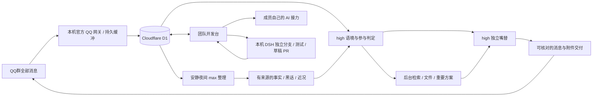

# TeamAgent · 做 AI 高手

一个常驻 QQ 群的项目搭子：能正常聊天、接梗和发表意见，也能检索资料、整理文件、记住团队决定、写方案，把开发接力交给合适的人。

源码、文档、Issue、CI 与后续 PR 统一在 **[OmnixSI/TeamAgent](https://github.com/OmnixSI/TeamAgent)**。本项目从个人 InkBoard 的 `team/` 拆出并保留该目录的提交历史；不依赖墨水屏、账本、邮件或私人记忆。既有服务地址暂时保留，群公告、成员登录和历史任务继续使用。

**[打开团队开发台](https://inkboard-team.inkboard-server.workers.dev)** · [完整复盘](docs/review.md) · [产品决定](docs/decisions.md) · [不再采用的做法](docs/declined.md) · [运维与恢复](docs/operations.md) · [验收记录](docs/verification.md)

## 怎么运转



- **参与判定**理解对话对象、上下文和气氛。被叫到、明确交办就处理；有新信息、好点子或合适的包袱可以主动参与。没有固定次数或时间配额。
- **嘴替**保留稳定的团队搭子身份。幽默来自具体语境，粗口和表情自然使用；工作、关怀与闲聊分模式，技术数据不做随机改写。
- **工作通道**把长检索从聊天移走。普通查询与小活 high；重要方案、编码推理和夜间归纳 max。复杂开发默认给成员接力。
- **记忆**只认有依据的原话。明确纠正即时记住，夜间归纳长期事实和表达，保留版本、来源、提议/决定区别和删除记录。
- **工作台**包含任务与方案、资料与发现、五个项目现状、记忆与成长、操作记录和运行状态。负责人、计划冲突、附件发送确认和接力材料都能查看。
- **执行**依赖可续租任务和版本校验，最多两轮修复；成果只到草稿 PR，不自动合并、上线或升级付费服务。

## 使用

成员打开开发台，点“用 QQ 群登录”，在目标群发送一次性 `/登录 ...`。每台设备有独立会话，管理员可以撤销。完整中文使用说明在页面顶部，登录前也可阅读。

直接自然说话即可，不必记仓库全名或每句 @Bot：“大肥鱼”“那个面试软件”“陪玩店那个项目”等会结合语境理解，不确定时追问。可选快捷命令：

```text
/方案 WhalePartner 梳理记忆检索接口的验收条件
/开工 NextThought-Website 为一个范围明确的问题补回归测试
```

群里直接交办数据和文件整理，生成实际附件后回传 QQ。困难工作从任务详情复制接力包，交给自己的本机 AI，完成后回填验证结果与 PR。

## 本地开发

Node 24+、Python 3.12+。本仓库有自己的依赖和锁文件。

```sh
npm ci
npm run check
npm test
npm run test:runner
npm run check:ui
```

Cloudflare 配置从 `wrangler.toml.example` 复制；先建 D1、两条免费档 Queues，再初始化 `schema.sql`。部署不自动写入密钥。

```sh
cp wrangler.toml.example wrangler.toml
npx wrangler d1 execute inkboard-team --remote --file=schema.sql
# 本机交互配置 ADMIN_TOKEN、RUNNER_TOKEN、DEEPSEEK_API_KEY、QQ_APP_ID、QQ_APP_SECRET
npm run deploy
```

`npm run deploy` 要求已提交源码，并把提交号写入 `/health`。既有部署的 Worker/D1/Queues 名称保留为 `inkboard-team*`，只是基础设施标识，不依赖旧仓库。部署和回滚详见运维说明。

## 参考与采用边界

| 来源                                                                            | 实际采用                                                                                              |
| ------------------------------------------------------------------------------- | ----------------------------------------------------------------------------------------------------- |
| [MaiBot](https://github.com/Mai-with-u/MaiBot)                                  | 重点学习参与调度、语境理解、表达选择和黑话学习；独立实现，没有复制 GPL 源码，也没有安装整套 MaiBot    |
| [AstrBot 自然聊天 skill](https://github.com/1rua/astrbot-qq-natural-chat-skill) | 短句、反话、未知梗追问、语境化 emoji、学会解释后的表达；融入实际提示与验收场景，不是安装 AstrBot 框架 |
| [WhalePartner](https://github.com/OmnixSI/WhalePartner)                         | 原文证据、事实版本、人格分层、经历与近况边界；团队库独立，不导入私人记录                              |
| [InkBoard](https://github.com/ooooooomygosh/inkboard)                           | 复用初期看板与 Worker 开发经验；代码已拆出，独立构建与维护                                            |
| [DeepSeek SuperAgent](https://github.com/deepseek-ai/dsh-superagent-prototype)  | 借鉴工作分解、隔离工作副本、恢复与交接；其研究原型不直接承担整套常驻系统                              |
| agent-autoloop / DSH                                                            | 现有本机接单与受限工作目录执行，独立版本回执、验证、草稿 PR                                           |
| [OpenClaw Dreaming](https://docs.openclaw.ai/concepts/dreaming)                 | 夜间离线整理思路；有新素材才运行，不把模型日记循环当作群友事实                                        |

QQ 使用官方 SDK 与官方长连接。官方云端 Webhook 尚未验收通过；当前电脑离线会暂停 QQ 收信、文件与代码工作，云端看板和数据仍在。扫描 PDF OCR、任意视频音频转写、全盘源码语义索引未作为已具备的能力。首次真实夜间整理和 24 小时连续运行仍需实际观察。
