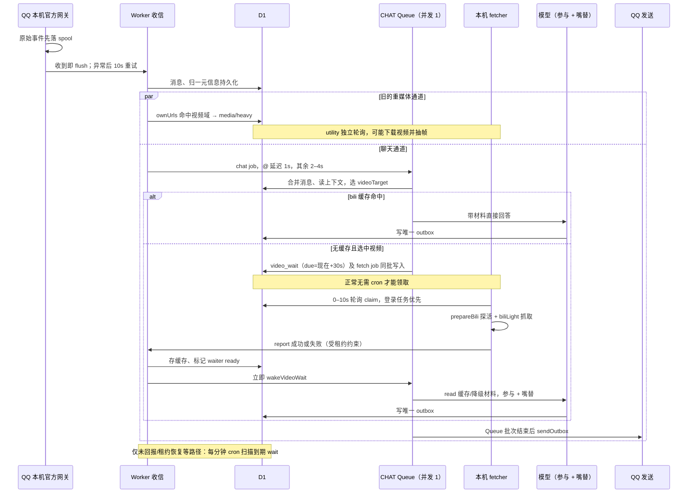

# TeamAgent 链接、卡片与 X 读取：代码链路与提速设计意见

结论：优先做“收到素材即预取、交互复用同一资源任务、缓存按真实内容编号归一、本机事件唤醒、到期有界降级”。不要把成功路径误当成必经 cron + 固定 30 秒，也不要以取消风控限速换速度。X 已有公开单推 oEmbed，缺的是登录态正文读取、最新推文和线程三个业务能力。

本报告只出设计，没有修改业务代码、提交、安装依赖、联网查询或触发真实群回复。依据为本地 `origin/main=0f67b289b2af019572e091254e1b42a9cbaac75a`（与实测记录的 release 一致），从现存 worktree 的 Git 对象导出临时只读基线后检查，避开各 worktree 未提交的登录修复。已读 AGENTS、README、decisions、declined、review。本文的路径与行号均对应该提交，可在 [固定版本源码](https://github.com/OmnixSI/TeamAgent/tree/0f67b289b2af019572e091254e1b42a9cbaac75a) 核对；“建议”与估算不是实测结论。

## 1. 现状时序与真正的等待

| 阶段 | 当前行为与理论等待 | 证据 |
|---|---|---|
| 网关转发 | 收到即持久化并 flush，不是固定等 10s；已有 flush 或网络失败时才受 10s 重试及前序 backlog 影响；单请求超时 20s | `runner/qq-gateway.mjs:52–92,107–116,139` |
| Worker 收信 | 存消息、卡片与引用边界；视频 ownUrls 另建 heavy media，不是新轻抓取预取 | `src/worker.ts:248–346` |
| 聊天防抖 | @ 1s，普通 2s、忙时 3s、裸图 4s；Queue 实际调度和积压另计 | `src/rhythm.ts:2–8`，`src/worker.ts:120–132,387–391` |
| CHAT 排队/预处理 | CHAT 并发 1；先看游标、批次和冷图，冷图路径可等待到 12s 再重投；视频判断在其后 | `wrangler.toml:24–29`，`src/worker.ts:663–720`，`config/team.json:85` |
| 视频目标选择 | 本条被 @ 的视频、引用视频、或“视频/总结”等提问关联最近 10 条；只分享普通链接未必触发轻抓取；选中才查缓存 | `src/fetchjobs.ts:30–49`，`src/worker.ts:716–720` |
| 缓存 | `bili:<ref>`：BV/短码 7 天，标题引用 24 小时；普通聊天命中就不建 video_wait | `src/fetchjobs.ts:52–55`，`src/worker.ts:718–741` |
| 等待与抓取入库 | 同一个 batch 写 wait 和 fetch；due 默认 30s，但 ready 可提前唤醒；同群同 ref 至多 3 个 active waiter，共享最早 due | `src/fetchjobs.ts:78–103`，`config/team.json:88–90` |
| 本机领取 | 空闲每 10s claim；`fetch` 不由云 Queue 执行；领取有 120s 租约，最多两次 | `runner/fetcher.mjs:203–211`，`src/lanes.ts:3`，`src/fetchjobs.ts:164–172` |
| 登录阻塞 | claim 先领登录任务；fetcher 在同一循环 await 登录，单次可占 5 分钟，期间不领内容任务 | `src/fetchjobs.ts:222–226`，`runner/fetcher.mjs:205–210`，`runner/qr-login.mjs:22–58` |
| B 站读取 | 每任务先 `prepareBili→check→nav`；再短链解析、设备/WBI 准备、view、player、字幕、评论。请求起始间隔 1.2–1.8s，单请求 8s；长链串行，没有总任务 deadline | `runner/browser-auth.mjs:81–89,242–247`，`runner/fetcher.mjs:65,76–90,111–158` |
| 成功/失败回报 | 成功存输入 ref 与真实 BV 两份缓存；失败也把 waiting waiter 标 ready，立即尝试入 CHAT；不必等 30s/cron | `src/fetchjobs.ts:186–220` |
| 无回报兜底 | 等到 due 后由 cron 扫描，约 30–90s 后才入回复队列，另计积压/模型/发送；cron 不是秒级定时器 | `src/fetchjobs.ts:150–162`，`src/worker.ts:1132–1144`，`wrangler.toml:10` |
| 模型回答 | 正常至少参与模型 → 嘴替两个串行调用；配置超时 90s + 60s；工具可能再转后台并多轮执行 | `src/semantic.ts:832–930`，`src/voice.ts:94–129`，`config/team.json:15–22` |
| 回复交付 | Queue 结束即 sendOutbox；最多读 5 行，D1 预算不足时留待后续调用。取 QQ token 最多 10s，发送一次最多 20s，引用失败可再发一次；未知结果不盲重发 | `src/worker.ts:919–959,982–1062,2332–2340` |

### 实测记录需要纠正的解释

1. **119s=60+30+10+14+5 并非这版代码的串行路径。** 正常 report 会提前 ready/wake，抓取与 30s 期限并行。按报告样本的领取 8.9s、抓取 13.6s、回灌 0.3s，加 @ 防抖 1s 和暂用的模型均值 5.3s，约 29.1s，再加数据库/Queue/QQ，而不是必然 50s。未回报路径应近似 `防抖 + 30s + cron 相位0–60s + 模型/发送`，不能继续叠加已并行的轮询/抓取。（`src/fetchjobs.ts:84–103,207–219`；实测记录 `TeamAgent-live-read-test.md:28–36`。）
2. **50s/119s 不能标成已验收 @→回复延迟。** 原记录明确说没有触发真实群全链路，A1 22.5s 测的是直插任务到抓取回报。`chat_decisions.model_ms` 在普通 chat 路径记录，video_reply 的 `runVideoWait` 未写该指标；35 次普通聊天均值不能直接证明视频回答 5.3s。（实测记录 `:15–17,34,53`；`src/worker.ts:733–760`，`src/fetchjobs.ts:120–135`。）
3. **二次直插绕缓存是成立的，不能扩展成“所有二次提问都不缓存”。** 用户聊天路径先查缓存，已有 W8 回归；`requestBili` 和 `claimFetch` 不查缓存，terminal job 会被重开。真正缺口是统一入口，以及不同短链/BV/p 分页之间的归一。（`src/worker.ts:718`；`src/fetchjobs.ts:57–69,164–169,207–209`；`test/fetchjobs.test.mjs:160–163`。）
4. **B 站抓取主要实现在 fetcher.mjs，local_bili_login.py 是登录。** Python 登录允许只保存三个会话字段，缺设备字段时只保留旧值；Node 登录流另有匿名设备补全。运行时 fetcher 也会 refreshBuvid，因此“文件缺 buvid3”不等于“请求始终缺 buvid3”，更不能据此认定 voucher 根因。（`runner/local_bili_login.py:203–224`，`runner/qr-login.mjs:68–78`，`runner/fetcher.mjs:124–137`。）
5. **标题检索明确匿名。** `biliByTitle` 使用 `{anonymous:true}`，HTTP Cookie 只允许 buvid3，不带 SESSDATA；登录成功仍搜索风控不意外。voucher 导致搜索暂停 6h；唯一匹配只覆盖搜索返回的第一页候选，并非全站唯一，不应尝试把 voucher 当通行证或直接切未验证的 App 接口。（`runner/bili-title.mjs:17–25`，`runner/fetcher.mjs:70–72`；`runner/test_fetcher.mjs:29–57`。）
6. **字幕不是“只取第一句”。** 当前选一个语言轨，再拼接该字幕响应 body 的所有 content，截 6000 字；视频只取 `pages[0]`/cid，未按 p 选分 P。41 字不能单凭长度判定缺句；应核对实际字幕覆盖时间、分 P、长文截断，不能把其它语言轨当后续分段。（`runner/fetcher.mjs:142–151`；`src/fetchjobs.ts:115,180`。）

真正优先级：消除交互前尚未开始的读取、避免轻/重双路重复、缩短本机领取等待、保住尾部 deadline 与发送机会；其后才是请求并行。无回报、登录占用、CHAT 并发 1、模型长超时和 outbox 留待 cron 才是尾延迟来源，当前不存在可信的绝对“最坏 119s”上界。（上表代码证据。）

## 2. 目标架构与可验收的时间预算

### 2.1 目标口径

- 定义 T0=本机收到这条明确交互，T1=云端持久化，T2=资源就绪，T3=答案持久写入 outbox，T4=QQ 确认接收。普通分享的预取起点单独记，不能拿源消息旧时间戳计算延迟。现有网关 spool、jobs.created_at、model_runs、outbox_attempts 可以承接最小观测，不需要第一步新建表。（`runner/qq-gateway.mjs:107–116`；`schema.sql:8–9,25,35`。）
- **顺利 ≤15s**：以健康 QQ/Cloudflare/模型、本机在线、轻量内容可读且负载受控为条件，验收 p95 的 T4−T0；预取命中期望约 1s 防抖 + 0.5s 查读/调度 + 5–8s 双模型 + 1–3s 发送，约 7.5–12.5s。上述为预算，现有数据不足以保证。（现有防抖/模型/发送依据见上一表。）
- 同条 @+冷链接的顺利预算：本机唤醒 ≤0.5s、轻抓取 5–7s、双模型 5–6s、其余合计 ≤1.5s，争取 12–15s；短链/冷 WBI/字幕大时可能超出，必须用样本验证后才能承诺。热评不应延长关键路径。（`runner/fetcher.mjs:124–158`，实测抓取 13.6s。）
- **最坏 ≤40s** 应具体化为“在外部服务健康时，40s 内发出有依据的内容或明确降级”，不是承诺风控、离线时也读取成功。建议交互总预算：读取阶段到 T0+12s 截止，参与+嘴替共用到 T0+27s，T0+30s 前持久写出唯一回复，剩余约 10s 交付；发送端也要按该回复的剩余 deadline 收紧现有 20s 超时，引用降级重发共用同一预算；QQ 无确认时保留 unknown，不能为赶 40s 盲目重发。基础设施中断/Queue 长期积压/QQ 自身超时无法保证 T4；分别统计未达标原因。（`src/worker.ts:1017–1062`；`src/fetchjobs.ts:129–147`。）

### 2.2 从收到素材开始预取，提问只订阅结果

建议收信完成消息与元信息持久化后：

1. 只从**本条 own 素材**提取候选，规范 ID、查 alias 与资源缓存；命中不抓，过期可返回旧版并后台刷新。当前读缓存点偏晚，应移成共享 `ensureResource()`，chat、prefetch、显式读取工具、重试入口都调用。（`src/worker.ts:307–346,716–720`；`src/fetchjobs.ts:52–69`。）
2. 未命中则持久写“资源任务”，不创建回复 waiter、不跑语言模型、不发群消息；只为支持的公开链接做有界预取，B 站无链接标题卡默认仅存卡片，不全群自动搜索标题。这改变的是获取资料时机，不改变是否插话的参与规则。（`docs/decisions.md:3–11`；`src/fetchjobs.ts:35–49`；`test/fetchjobs.test.mjs:33–41`。）
3. @/引用/明确提问创建“回复订阅”，挂在同一资源任务上；预取正在运行时只加 waiter、提高优先级，不开第二次读取；快照关联到准确原消息和 ref，不能批次里有一个 transferred 就吞掉后来另一条独立 @。（当前批次短路 `src/worker.ts:716–724`；waiters 和租约 `src/fetchjobs.ts:60–65,196–219`。）
4. **处理轻重双路**：B 站链接目前一进群就建 media/heavy，随后提问又建 fetch/light。普通“讲啥”改走共享轻读取；下载/抽帧/文件生成留给用户明确要画面、音轨分析、深度资料任务时升级，同一个 contentKey 复用已有字幕元数据。不得让轻任务完成后，旧自动 heavy 再发另一份答案。（`src/worker.ts:319–346,1553–1569`；`runner/utility.py:229–273`。）这是产品行为变更，架构方案需明确取舍；本建议选“轻读默认、深读按意图升级”。
5. 每条消息候选有界、交互优先于预取、相同资源合并；预取不自动补抓历史转发，不下载所有预览图、不跑全视频。现有 own/quoted、attachments 边界继续保留。（`src/bili-links.ts:5–32`，`src/inbound.ts:79–102`，`src/policy.ts:38–54`。）

### 2.3 缓存键与结果层级

第一阶段沿用 `media_notes(id,body,created_at)`，新键放结构化 JSON；不要求直接迁移数据库。旧 `bili:<ref>` 缓存可只读兼容，实际接入由架构方案确定版本转换。（表结构 `schema.sql:13`；现有读取 `src/fetchjobs.ts:52–55`。）

| 建议键 | 保存什么/时效起点 | 依据和注意点 |
|---|---|---|
| `alias:v1:<provider>:<sha256(normalizedURL)>` | 原链接→canonical ID；B 站短链成功映射可复用 7 天；失败网络不固化映射 | 当前只给同一 short 和 BV 各存一份；另一短链不会复用，`src/fetchjobs.ts:207–209` |
| `resource:v1:bili:<BV>:p:<page>` | 真实 BV 与分 P；元数据/字幕分别标 fetched_at、覆盖范围、状态；字幕建议 7 天，统计/评论例如 10 分钟 | 现有统一 7 天且没有 page，`src/fetchjobs.ts:54`、`runner/fetcher.mjs:142–158`；具体 TTL 是建议值 |
| `title:v1:bili:<hash(normalizedTitle+knownAuthor)>` | 候选映射与 confidence，保留“标题匹配”的 provenance；不升格为确定 ID | 当前 NFKC/空白归一/FNV64、24h 成功与 miss，`src/bilititle.ts:7–26`、`src/fetchjobs.ts:54` |
| `resource:v1:x:status:<id>` | 正文、作者、发布时间、公开/登录来源、读取时间、完整性；例如 10 分钟后刷新，已编辑内容不能永远固定 | 当前 readUrl 完全无缓存，`src/semantic.ts:388–453` |
| `resource:v1:x:latest:<userId>:<originals-or-all>` | 时间线候选 ID 集、抓取时刻、覆盖窗口；例如 30–60s，绝不和单推/线程共享“最新”语义 | 当前无该业务能力，`src/semantic.ts:336–350,396–423` |
| `resource:v1:x:thread:<rootId>:<scope>` | 有序推文 ID、replyTo 关系、缺口与 complete=false/true；例如 1–5 分钟 | oEmbed 只是单条 HTML，当前无线程组装，`src/semantic.ts:378–419` |
| `failure:v1:<provider>:<identity>:<reason>` | unavailable/deleted/risk/network 等定类，retryAfter；网络例如 5–15s、删除需可证状态、搜索遵守现有 6h 熔断 | 现有只有 title miss 缓存，风险没有共享结果，`src/fetchjobs.ts:52–55,212–213`、`src/bilititle.ts:20–30`、`runner/bili-title.mjs:22` |

URL 归一：协议/host 统一、白名单解析跟踪参数，B 站必须保留 p，X 以 status ID 为主键；普通网页 query 可能改变内容，不能全删，也不能普遍小写路径。缓存的正文与标题匹配证据分开保存：同一 BV 内容可复用，但从标题卡命中的那次回答仍带“可能不是原视频”；负缓存不得覆盖已有可用正文，临时登录态失败不污染公开可读内容。（现有字段/不确定性规则 `src/inbound.ts:44–55`、`src/bilititle.ts:25–30`。）

资源任务先按已知 canonical ID 去重；未知短链先做解析，获得 ID 后再加入同一资源任务。不同未知短链并发解析到同一 BV 的竞争要 CAS 合并，不能粗暴重开已运行任务或覆盖租约。抓取版本/租约到期旧结果必须被拒绝，沿用现有 report fencing。（`src/fetchjobs.ts:57–65,196–219`。）

### 2.4 本机近实时领取与 Cloudflare 边界

**首选不新增基础设施：利用已有 QQ 本机网关做唤醒。** Worker 收信在 D1 预取任务提交后给网关响应一个不含正文/凭据的 wake hint；网关通过本机 Unix socket 或原子写入 wake 文件通知 fetcher；fetcher 被唤醒后仍向 Worker claim，由云端租约决定拿什么，而不执行 hint 里的任意 URL。定期慢轮询与启动扫描保留，hint 丢失不会丢任务。（现有“本机收到消息→await flush→读取 Worker 响应”位置 `runner/qq-gateway.mjs:68–86,107–116`；云端 claim `src/fetchjobs.ts:164–169`。）

- 无任务仍 10s 兜底，收到新消息或活跃交互期间可短时 0.5–2s，空闲退避；领取循环与执行/登录解耦，同服务 profile 互斥，B 站已有会话不被 X 登录占住。限速器与熔断仍按服务共享，避免多个 client 各自限速叠加请求。（`runner/fetcher.mjs:61–67,203–211`，`runner/browser-auth.mjs:121–131`。）
- **只改成全天 2s 轮询并非“无成本”。** 仅空闲 claim HTTP 就从 8,640 次/日变成 43,200 次/日；每次正常路径至少读 pause、写 fetcher:last-seen、尝试 claimLogin、尝试 claimFetch，约四条 SQL 的调用形状。SQL 调用数不是计费行数，但有 D1 写入与 Worker 请求负担。last-seen 应按例如 30s 节流写，在线判断容忍窗仍与之匹配。（`src/worker.ts:1350–1354`；`src/fetchjobs.ts:223–226`；`src/login-flow.ts:21–22,40–48`。）
- 已有 Queues 是**云端生产/Worker 消费**；把 kind=fetch 改发 WORK 不能自动让 Node 进程醒来。若另选 Queues HTTP pull，需同事调研确认当前免费档支持、凭据作用域、请求开销及与现有 push consumer 拓扑能否共存，不能当作可原样替换的免费长轮询。（当前配置 `wrangler.toml:11–41`；本地 fetch 路由 `src/lanes.ts:3`。）
- 云 Worker 不能直接连 NAT 后的本机 loopback。WebSocket+Durable Object 可作为跨来源后台任务即时通知的候选，但需要新增绑定/状态路由、重连和费用核验；普通 Worker 的内存 Promise/长轮询不能当跨实例可靠通知。长连接只负责提醒、D1 仍是权威；此次不把它列为先决条件。平台额度、DO 免费资格、连接寿命等均未联网核验，不在此报告冒充已确认。（仓库架构约束 `AGENTS.md:13–16`、既有绑定 `wrangler.toml:5–41`。）
- 网页/X 云侧预取可走现有 TOOLS；B 站本地读取走唤醒机制。后台刷新、其它群消息来源、丢 hint 情况用轮询恢复。QQ 网关与 fetcher 在不同主机时此首选方案不成立，应切换经过核验的出站通知方案。（本机部署边界 `README.md`“官方长连接”说明。）

### 2.5 到期唤醒、并行和快速降级

1. `startVideoWait` 不再以“30s 后等 cron”兜底：创建 waiter 后立刻为**实际共享 due_at**写持久 deadline job，并用已在用的 Queue `delaySeconds` 定时唤醒。资源 report 仍立即唤醒；二者竞态只有一个答案。不能只在入队前调用一次 `wakeVideoWait`，因为它会因尚未 ready/due 拒绝建 job；也不能给同 id reply job 留一个未来 notBefore，挡住早到成功回报。建议独立 `resource_deadline` job 到期再 wake。cron 继续只做断电、丢唤醒和过期租约恢复。（`src/worker.ts:120–132`；`src/fetchjobs.ts:85–103,120–147`。）
2. 资源 waiter 分开存 due 与 generation；现有最早 due 共享语义要保留或明确修改。完成答案后 late report 可更新缓存，不能自动再发；新一条明确追问可命中新材料。旧租约结果、重复 report、deadline/report 竞态继续 fencing。（`src/fetchjobs.ts:85–88,131–135,196–219`；`test/fetchjobs.test.mjs:94–159`。）
3. B 站先 view 确认身份与 cid，再让 player→字幕和评论有限并行；共用现有 1.2–1.8s 起始间隔，最多两条在途请求，播放器/字幕优先。评论仅用剩余预算，不等评论才返回已可用字幕；超时/风控有部分元数据仍返回 partial。不同网页最多 2 个并发，逐个页保留失败结果，不让单个慢源串行吃完整个预算。（当前串行 `runner/fetcher.mjs:134–158`；`src/semantic.ts:472–488,933–938`。）这类收益预计数秒，需实测；不能声称 Promise.all 一定省 3–5s。
4. `prepareBili` 不要每视频必探 nav+写状态；以会话文件更新/mtime 与短时探活缓存复用，401/明确过期才失效。WBI 已有 12h 内存缓存、buvid 已有 24h 内存缓存，避免再次造缓存；设备补全应统一成同一个原子保存 helper，Python 登录不把“设备完整”冒充“会话有效”，也不在关键路径要求重新扫码。（`runner/browser-auth.mjs:81–89,242–247`；`runner/fetcher.mjs:124–132`；`runner/local_bili_login.py:203–224`。）
5. 总 deadline 必须贯穿 network、模型、outbox，取消要实际 abort 请求/关闭读页，不只是 Promise.race 提前返回。现有 modelSettings 会按 kind 覆盖传入 timeout，所以单把 `model(..., 5000)` 改小不生效；需要新增 scoped deadline/AbortSignal，并取配置 timeout 与剩余预算的较小值。只作用于链接交互，不缩短正常规划、研究全局超时，high 档位与独立嘴替不变。（`src/runtime.ts:44–64`，`src/config.ts:8–23`，`src/semantic.ts:838–847`，`src/voice.ts:94–129`。）
6. CHAT 并发 1 上的长视频回答和冷图可阻塞别人的 @。先让资源获取与回答生成走工作通道，CHAT 只做短路由/提交，或为所有 chat 工作施加有限占用；不得简单提高 CHAT 并发而破坏共享游标。TOOLS 也有长 research，能否给 deadline 留出及时消费机会必须压测；没有负载/外部可用性条件，就不能签“绝对 ≤40s”。（`wrangler.toml:24–29,34–42`；`src/worker.ts:655–705`；`src/lanes.ts:4–10`。）
7. 对已明确的失败，直接用短模板写 outbox，不再通过两轮模型解释，防止失败链路比成功更慢。最少定类：`risk`、`offline`、`timeout`、`not_found/forbidden`（有依据才细分）、`partial`、`ambiguous`；fetcher 不能统一抹成“视频未读到”，Worker 也不能丢 reason。原始异常和 Cookie 不进模型/群消息。（`runner/fetcher.mjs:172–182`；`src/fetchjobs.ts:212–213`；`AGENTS.md` 私密边界。）

建议群内话术（成功内容按真实范围生成；以下失败模板无需模型）：

| 真实状态 | 简短回复 |
|---|---|
| 有标题无确定 ID | “这张卡片只带标题和封面，没拿到视频地址。点 B 站‘复制链接’发我，我才能核对内容。” |
| 标题匹配 | “按标题找到了 UP 主「…」的 BV…，可能不是卡片原视频。下面依据该视频的字幕……” |
| 受风控 | “B 站这次拦住了读取，暂时只有卡片信息，不能据此总结视频。” |
| 可用元数据，无字幕 | “读到了标题和简介，没读到字幕或音轨。以下只概括简介……” |
| 本机离线 | “读取端暂时离线，这次还没拿到正文。” |
| 已超预算 | “这次正文没能及时读完，先给你已确认的部分：……。” 没有可确认内容就明确说没读到，不承诺自动续发 |
| X 最新性不足 | “拿到了这条推文，但没能核实它就是最新一条。” |

模板承接现有卡片/字幕来源诚实性，不宣称听过音轨、看完画面、已核实最新。（`src/bilititle.ts:5–6,25–30`；`src/fetchjobs.ts:105–115`。）

## 3. 链接与卡片识别：支持、遗漏、可靠补救

| 输入形态 | 当前真实支持 | 漏点/建议，含证据 |
|---|---|---|
| `https://b23.tv/<code>`、裸 `b23.tv/...`、转义 JSON | B 站专用递归能识别，短码仅 4–12 位字母数字能进入轻抓取；普通 ownUrls 只识别带协议的原文 | B 站候选与泛链接采用两套提取，裸短链不会自动 heavy，但可经视频目标轻抓；统一资源入口，`src/bili-links.ts:7–23`、`src/inbound.ts:48–50,91–93`、`src/fetchjobs.ts:24–33` |
| B 站 BV、`player...?bvid=BV...`、裸 BV | 递归解析 JSON/转义，URL path/query 及裸 BV 可识别 | URL 编码包裹尚未解开；不要从任意非 B 站 URL 路径里抠 BV，`src/bili-links.ts:11–23`、`src/inbound.ts:52–55` |
| `.../av123`、裸 av、`aid:123` | av URL 能解析成 `{aid:'av123'}`，但 `refIn` 不接 aid，所以轻抓取不支持；裸 av/数值 aid 也不支持 | 增加 typed aid→view→canonical BV；只在已知 B 站来源/字段识别裸数，`src/inbound.ts:53–55`、`src/fetchjobs.ts:26–33`、`runner/fetcher.mjs:134–142`；现有测试还断言 av 不进入视频目标，`test/fetchjobs.test.mjs:161` |
| QQ ark `fields` 对象/数组、`jump_url` | parseCard 支持 type/name/title/desc/jump_url/preview/source；递归能在其它字段发现直接 B 站地址 | title/desc 等仅限已知 fields 结构，非所有 QQ miniapp schema；`src/inbound.ts:35–42` |
| `qqdocurl`、嵌套 `meta.detail_1` 等 | 若字符串值是普通 B 站 URL，递归能找到，不依赖字段名；但不是 qqdocurl 专用 resolver，也不会把所有 meta 字段映射成 Card | percent-encoded 的 qqdocurl、腾讯跳转 URL 中编码的内层地址、外层 source/title 丢失；建议 schema adapter + 有界 decode + 安全 resolver，`src/bili-links.ts:7–23,29–32`、`src/inbound.ts:35–42,79–98` |
| 仅标题/封面 B 站卡 | 若 fields.source/ark_name/prompt 可识别 B 站且 title 合法，就 titleRef→匿名 WBI 搜索；严格唯一全同名才读取并标不确定 | 不等同于原视频，voucher 已实测；fixtures 自认推测结构，新增格式必须用真实脱敏样本，`src/bilititle.ts:7–26`、`runner/bili-title.mjs:12–25`、`test/fixtures/bili-card-inferred.json:2` |
| preview/source_logo、附件 | 专用 B 站扫描刻意不扫描这些分支，防止把封面/签名资源当视频 | 泛 ownUrls 仍会 regex 扫 JSON ark，可能带预览 URL，应区分 display asset 与 content link，而不是把整个 raw 扔给普通链接读取，`src/bili-links.ts:28–32`、`src/inbound.ts:91–92` |
| 引用/转发 | msg_elements/quoted 单独归类；引用旧视频不是自动重跑信号，明确问才取目标 | 扩大扫描时保留 owned/quoted 标识；不能从卡片内容制造用户交办，`src/bili-links.ts:32`、`src/worker.ts:319`、`src/fetchjobs.ts:39–47` |
| 微信文章、抖音、小红书及其它短链 | 普通 http(s) 进入 ownUrls 并可由模型 read_web，经 Jina→DeepSeek；没有微信/抖音/小红书专用正文/视频解析器 | 不具备“这些平台全支持”的证据；无协议非 B 站短链、复杂卡 schema、App deep link、登录页/JS页缺专用处理；`src/policy.ts:38–54`、`src/semantic.ts:424–453,1155–1163`、`src/worker.ts:321–328` |
| X/Twitter 单推、个人页、t.co | 标准 `/<user>/status/<digits>` 有 oEmbed；个人页/t.co 只走泛网页路径，未有时间线能力 | `/photo/1`、`/video/1`、`/i/web/status/id` 未归一，t.co 跳转后不重派发到 X adapter；`src/semantic.ts:336–350,395–453` |

### 没链接的卡片：按可靠性排序

1. **先解析实际卡片字段。** 已存在裸 BV/URL 的递归无需重写；补结构化 `bvid`/`aid`/`video_id`/URL query/受信来源 deep link adapter，将字段和所属 own/quoted、原消息 ID 一起保存。数值 ID 要能确定是视频 aid，不能把 appid/封面哈希误认视频。（当前 `src/inbound.ts:9,35–55`、`src/bili-links.ts:5–32`。）
2. **qqdocurl/跳转参数优先于搜索。** 已是直接 B 站地址直接取；有界解一到两层 URL 编码/HTML 实体，再对已知跳转 host 手动跟随有限跳数，逐跳验证 scheme、目标域/公网地址，禁凭据外送。跳转到 BV、av 或 player query 才算确定命中。复用本机 safe lookup/短链安全约束，不能把 allowlist 放宽成任意跳转。（当前边界 `runner/fetcher.mjs:22–35,53–57,111–122`。）
3. **已知映射可复用，预览图不可通用逆算。** 给未来成功读取的“封面 URL/规范图片哈希→若干 BV”建有来源的索引，且标题/作者/时长互相验证；无历史映射时，hdslb 内容哈希不具备代码里任何可逆为 BV/aid 的规则。同封面复用/转载时仍可能不唯一。OCR 最多恢复封面文字/水印，不能证明原视频。此路线只作候选补证，不作为发布第一批必成能力。（当前 preview 仅展示 `src/inbound.ts:42`，专用扫描排除 `src/bili-links.ts:28–32`；缺逆算实现是代码事实，真实可查路径待调研。）
4. **最后才标题搜索。** 保留严格匹配和来源不确定性，不把多候选第一条当原视频；风控/冷却直接落“仅卡片”。已登录浏览器搜索是否改善需真实样本证明；先不增加 App 签名或验证码处理依赖。（`runner/bili-title.mjs:12–25`、`src/bilititle.ts:25–30`。）
5. **确实只剩标题封面时，及时让对方复制链接。** 这是有依据的能力边界，不应在模糊标题上花 30–90s 或编造正文。（`src/bilititle.ts:5–6,28–30`。）

## 4. X 的现状与建议接口

### 4.1 当前缺口

- **公开单推已实现**：严格匹配 status URL→`publish.x.com/oembed`→去 HTML/实体解码→文字。8s 超时，非 2xx/异常就 null，不会再落 Jina；有测试显式固定此行为。不能再把“增加 oEmbed”列为新功能。（`src/semantic.ts:336–423`，`test/web.test.mjs:200–230`。）
- **登录流程≠读取功能**：owner.py 只开登录、读进度、确认重试；native-x-browser 只拉起真实浏览器并 CDP 连接。auth.login 成功后 open 的 finally 会 close，上次端口不能视为常驻读取服务；默认 check('x') 仅返回上次本地状态，不重新验证。`nativeXArgs` 固定打开登录页且没有 `--headless`，传入 headless 只改变启动等待期限，不能把现有 helper 视为无窗口后台 reader。（`runner/owner.py:90–157`，`runner/native-x-browser.mjs:35–43,44–90`，`runner/browser-auth.mjs:142–160,187–219`。）
- **fetcher 只接受 bili/light**；没有 X job 类型、返回 schema、时间线作者过滤、分页、线程 replyTo 组装、资源缓存或“最新”检验。群里自然语言“看马斯克最新推文”最多依赖模型 search_web/read_web，不具备可确认的时间线业务实现。（`runner/fetcher.mjs:172–180`；`src/semantic.ts:742–765,1146–1163`。）
- oEmbed 文本没有结构化推文时间/原推与引用关系/完整性字段；不能单凭“有正文”证明最新、完整长文或整条线程。（`src/semantic.ts:378–419`。）

### 4.2 建议读取结构

统一入口 `readResource({provider:'x', operation:'status'|'latest'|'thread', target, scope, deadline})`，返回固定安全 schema：`statusId, authorId, handle, createdAt, text, permalink, replyToId, quotedStatus, source, fetchedAt, completeness, warnings`；latest/thread 用结构化 items 与覆盖范围。只回正文和元数据，不回 Cookie、CDP 地址或整个浏览器页面。（承接 `src/semantic.ts:1155–1163` 不可信工具材料包装；现有登录元数据白名单 `runner/native-x-browser.mjs:23–33`。）

1. **单推**：查缓存→公开单推优先现有 oEmbed（小预算例如 2–3s）；失败/内容不完整且已有可用登录态，再本机登录 profile reader 补读；具备 auth 的任务也可直接登录态读取。两条来源共用总 deadline，不能先 8s 再等启动 10s 再来完整模型超时。脱敏 DOM fixture 验证是否正确，当前无法声称公开免登录一定成功。（现有 oEmbed 时限 `src/semantic.ts:403`，原生启动窗口 `runner/native-x-browser.mjs:49`。）
2. **最新推文**：明确“最新公开发帖”的默认口径为本人原帖、含本人回复、排除置顶导致的排序假象与纯转推；需要“最新动态含转推”则带不同 scope。根据 timeline 中实际 authorId、timestamp、status ID 判断，显示链接和发布时间，并写“截至读取时”。读取本人 replies 要确认实际覆盖，不够就说“当前读到的最新”，不能用搜索引擎陈旧摘要冒充。马斯克可从已核验账号映射进入，作者身份不能只看昵称。此口径要交架构师定案，现有代码没有默认值。（缺口依据 `src/semantic.ts:336–350,396–423`。）
3. **线程**：从指定 status 按 replyTo/conversation 关系取同作者相连节点，限制例如最多 10 条/固定时间；普通评论、引用推文分开，不把页面相邻帖子串成线程；缺前文/后文标 incomplete，不能宣称“完整线程”。（当前只 HTML 展平，`src/semantic.ts:378–419`。）
4. **登录态 reader 独立于交互登录**：复用 profile/原生浏览器启动与域名控制，每 profile 一把锁；已打开交互登录窗口时明确 busy，避免另一进程启动同 profile。持续复用浏览器的收益、空闲关闭时机、无用户在场时会否弹窗/触发验证，必须先实测；不能直接拿登录 helper 更名当 reader。（现有锁 `runner/browser-auth.mjs:121–131`，原生打开 `runner/native-x-browser.mjs:44–90`。）
5. **免登录兜底是降级**：单推仍用已存在 oEmbed；个人时间线/线程没有已验证的匿名 fallback。Jina/公开索引可作为带日期的旁证，不能证明最新；不把某个第三方镜像域名硬编码进核心。外部新 API/项目等并行调研结果再定。（`src/semantic.ts:396–453`。）
6. **登录健康与内容可读健康分开**：记录 `authObservedAt` 与最近成功 `statusReadAt/timelineReadAt`，登录 ok 不等于现在可读，网络失败不强制标过期，也不在每次抓取前重开登录窗口。（`runner/browser-auth.mjs:91–96,215–219`、`src/auth-status.ts:7–14`。）

## 5. 拆成 8 个可交付小任务（设计建议，不是本次实施授权）

| 顺序/任务 | 文件与改法 | 预期收益 | 实施风险 | 测试办法/依赖 |
|---|---|---|---|---|
| 1. 统一时序与最小回归 | `runner/qq-gateway.mjs`、`src/worker.ts`、`src/fetchjobs.ts`；沿 jobs payload/本机脱敏日志记录 receipt/ingest/claim/fetch/report/模型/outbox/QQ ack；明确 trace 与资源 ID | 能区分真耗时、Queue 等待、未发送；先校正 50/119s 说法 | L1，字段严禁正文/凭据 | 现有 mock 回报立即 wake、W8 命中；补纯时间仿真，真实端到端需后续指定群验收；无依赖 |
| 2. ID 与卡片 adapter | `src/bili-links.ts`、`src/inbound.ts`、`src/fetchjobs.ts`、`runner/fetcher.mjs`；typed BV/aid/page/短链、qqdocurl/受控编码解包，X URL 归一 | 已有 ID 直接命中，减少错误标题搜索和分 P 串片 | L1；错误 ID 可能引用错内容 | 脱敏真实卡 fixture + own/quoted/preview 边界；av、aid、p、嵌套 qqdocurl、恶意跳转；依赖 1 |
| 3. 统一资源缓存 + 收信预取 | `src/worker.ts`、`src/fetchjobs.ts`、`src/semantic.ts`，必要时新增资源模块；JSON 版本键复用 media_notes；共享 fetch 与 waiter，取消默认 B 站双路 heavy | 提问命中缓存省去整段读取；同视频多短链/多成员只抓一次；减少重复答案与下载 | L2，跨通道/产品默认改变 | 并发多个别名、运行中加订阅、直插入口命中、负缓存不盖成功、标题来源不丢、轻读不再自动重媒体；依赖 2 |
| 4. 本机事件唤醒 + 领取解耦 | `runner/qq-gateway.mjs`、`runner/fetcher.mjs`、`src/fetchjobs.ts`、`src/login-flow.ts`；commit 后 hint、本机唤醒、慢轮询恢复、last-seen 节流、登录不挡 B 站 | 领取从 0–10s 降到亚秒目标；避免 5 分钟登录阻塞及全天高频轮询 | L2，丢唤醒/进程协调 | hint 丢失/重复、spool 重放、fetcher重启、断网、socket 断开、登录同时 B 站抓取、共享限速；依赖 3 |
| 5. 准时 deadline 与有界回答 | `src/fetchjobs.ts`、`src/worker.ts`、`src/lanes.ts`、`src/runtime.ts`、`src/voice.ts`；独立 deadline job、early report 不受 notBefore 阻挡、贯穿 deadline、失败直接模板、保持游标顺序 | 移除未回报路径 0–60s 巡检相位；控制模型尾耗时与重复回复 | L2，幂等/租约/Queue 竞争 | 假时钟：提前成功、提前失败、deadline/report 同时、晚成功、失效租约、模型卡死、CHAT忙、D1不足、QQ unknown；依赖 1、3，可与 4 并行 |
| 6. B 站关键路径与会话设备 | `runner/fetcher.mjs`、`runner/browser-auth.mjs`、`runner/local_bili_login.py`；会话探活短缓存、设备原子补全、player/评论有限并行、subtitle 分 P/覆盖标记 | 冷读取争取减少数秒；保留可用部分、减少反复 nav | L1，风控和字幕范围 | 保持 1.2–1.8s 调度断言、风控暂停、单接口超时不丢 view、Cookie 隔离、没有 buvid 的真实链路；依赖 2、3 |
| 7. X 三种读取能力 | `src/semantic.ts`、资源模块、`runner/fetcher.mjs`、新增 `runner/x-reader.mjs`；复用 `native-x-browser.mjs` 的本地启动边界，不混登录检测与正文读取 | 补上最新/线程；单推缓存，免登录失败有登录态补读 | L2，DOM/账号/长文变化 | status、最新非置顶、回复/转推 scope、长文/引用、部分线程、登录过期、profile busy、原生 CDP失败；依赖 2–5，并以并行 X 实测决定 reader 路径 |
| 8. 全链路验收与运维 | `scripts/evaluate-timing.mjs` 或独立验收脚本、相关 tests、`docs/operations.md`、`docs/verification.md`；记录逐样本 trace 与回滚点 | 判断是否真的 ≤15/≤40，避免仅测直插任务；持续观察请求/写入成本 | L1，不自动向群群发测试 | 依赖 4–7；正常样本各约 20 次并记录分位数/失败率；受控故障逐例验收；群消息发送另由已有授权的交付链路执行 |

任务 4 的本机唤醒实现样板、任务 2 的脱敏 fixture、任务 8 的重复运行脚本可交机械成员；主程保留任务 3/5 的状态机、缓存 provenance 和超时一致性。所有实施必须先有架构师 `.agent/plans/...` 与交付员基线 worktree。新增 DO/Queue 绑定、数据库迁移、依赖或 CI 不夹带进任何上述小任务，另立方案；第一批无需新依赖/表。（工作室边界及 `AGENTS.md` 的 D1/Queues、租约约束。）

## 6. 本次实际检查与仍待验证

### 已做检查

- 从现存仓库读取固定 main 对象到独立临时目录，未切分支、未读本机 secrets、未改变任何活跃 worktree 文件。
- 对快照生成 UI 必需文件后复用现有 node_modules，执行 `node --test --test-reporter=tap test/inbound.test.mjs test/fetchjobs.test.mjs test/web.test.mjs runner/test_fetcher.mjs`：**148/148 通过**（包括 runner 的 browser-auth/QR 子测试）。首次运行因快照缺生成的 ui.generated 失败，补跑原有 build-ui 后通过；不是业务基线失败。未跑无关全库构建/类型检查，因为未改业务代码。
- 在临时快照另跑离线探针，实证：① av URL 有 aid 但 target=null；②裸 av 无候选；③数值 aid 卡走标题；④普通 qqdocurl 可找 BV；⑤percent-encoded qqdocurl 漏掉；⑥合成 meta.detail_1 中直链可识别但标题不被 parseCard 收集；⑦收信后 jobs=chat+media，chat 后再添 fetch；⑧失败 report 在 due 未来时已建 video_reply，但 jobs.error 只有“本机抓取未完成”；⑨同一单推连续 readUrl 发两次请求；⑩/photo/1、/i/web/status 不命中 isTweet。
- 探针仅用了合成数据、内存 SQLite、mock HTTP，验证代码分支，不证明 QQ 卡片真实平台覆盖或 X 真实读取成功。日志留在 `/tmp/teamagent-main-design-checks.tap` 与 `/tmp/teamagent-main-design-probes.log`。

### 要交给架构师/实测者的未定项

1. **全链路真实分布仍缺**：需 T0/T4 trace、queue wait、video model 双调用耗时、QQ ack 耗时；报告的 22.5s 是抓取回路，50/119s 不能作为实测基线。（实测记录 `:15,36,53`。）
2. **同机唤醒前提**：现有部署是否所有相关 QQ 来源与 fetcher 同机、网关响应扩展是否与官方回调分路；必须按真实部署验收。若不成立，用已调研确认的出站通道替代。（`runner/qq-gateway.mjs:68–76`、`src/worker.ts:393`。）
3. **Cloudflare 版本与免费额度**：Queues 延迟投递已有代码用法，但平台实际时延、消费积压、HTTP pull、DO 和 WebSocket 的免费支持未核实；本报告没有联网，不给未经核验的额度/延迟承诺。（`wrangler.toml:9–41`、`AGENTS.md` 免费约束。）
4. **卡片真实 schema**：qqdocurl、数值 aid、meta.detail_1、预览索引是否在实际 QQ 官方事件可获得；当前 fixture 仍写推测，不能用其它机器人框架的卡结构当本项目已收得到。（`test/fixtures/bili-card-inferred.json:2`。）
5. **B 站设备与风控因果未确定**：缺 buvid 的文件、进程内已补全、匿名搜索 voucher 是不同现象；不能把补 Cookie 包装成保证解除风控。登录浏览器搜索成功率待外部实测，先保留严格回退。（`runner/fetcher.mjs:124–137`、`runner/bili-title.mjs:19–22`。）
6. **X 正文/最新/线程实测待并行同事结果**：本次没有浏览器环境，也未尝试复用用户浏览器/profile；只能确认登录实现和 oEmbed mock 测试，不能宣称已读到马斯克最新推文。账户映射、置顶/回复/转推口径、长文展开和线程覆盖需定案。（`runner/browser-auth.mjs:215–219`、`src/semantic.ts:396–423`。）
7. **缓存 TTL 与产品默认**：上文 TTL 是起始建议；“默认轻读，画面分析按需升级”“只剩卡片不自动全群搜标题”“最新是否含回复”都须架构方案明写，不在实施时临场决定。（`src/worker.ts:319–346`、`src/fetchjobs.ts:35–49`。）
8. **15 秒冷读取能否达标**：保留风控间隔时只并行评论未必足够，网络 RTT、冷签名/设备、模型方差需要数据；15 秒主要靠预取/缓存收益，冷 miss 失败也应按约定尽快诚实回复，不能以降低完整性或编造填满目标。（`runner/fetcher.mjs:65,124–158`。）

报告本身风险 L1（只读检查与设计文档）；建议实施中的资源状态机、本机调度、deadline 和 X reader 默认按 L2 审查。剩余工作是架构定案与真实验收，本次不提交代码或宣称上线收益。
