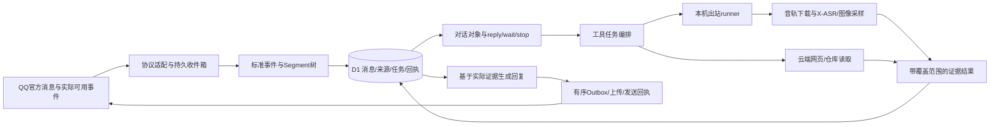

# TeamAgent QQ 机器人全链路独立调研（Codex，2026-11-13）

## 结论

**推荐保留 Cloudflare Worker + D1 + Queues 的权威状态与任务调度，一次性建设“协议适配—结构化消息—媒体证据—参与决策—工具执行—发送回执”的完整版本；优先移植成熟模块的行为和测试样例，适合 runner 的 Python/Node 模块可原语言接入。**[现架构与交付约定][T-doc]、[官方消息codec][M-official]、[图像/动图预处理][A-media]。 AstrBot 是技术上最值得做对照原型的整套替代方案；MaiBot 是参与调度与表情包管理的重要来源；NoneBot/Koishi 是协议、消息段与中间件来源。不能把框架功能清单直接视为 QQ 官方接口的能力清单。

用户关于重复造轮子的批评有依据：引用取回、消息段、动图采样、notice 分流、发送失败分类都已有可读实现；TeamAgent 应从逐个 URL/字段修补，转为统一消息契约与整条链路验收。**一次大版本上线可行；一次写完、不做中间验证、仅凭本机测试保证线上全部最好，不是现有证据能支持的承诺。**建议模块内持续验证、统一候选版本验收、一次上线，避免每个小补丁独立走一整轮发布。

范围与证据：本报告独立完成，未读取 DeepSeek 的本轮报告；读取公开源码快照、GitHub 元数据、官方文档、相关 issue，并只读检查 TeamAgent worktree。源码亲核不等于集成验证；另离线复跑23项上游解析检查。未运行机器人、未下载媒体、未调用模型、未改 TeamAgent。工期与目标架构均为工程估计/建议，非测量值。许可证按用户补充压缩记录，不以它否决技术路线。

**现时变化：NapCat 主仓固定快照 `105f38e3ecb1428c147e0f9165f65f854233d988` 仅有 Ending README，官方文档站返回 404；搜索索引仍显示旧 release，存在明显时效冲突。**本报告不把旧索引当成当前可安装/可维护的保证。[现行 README](https://github.com/NapNeko/NapCatQQ/blob/105f38e3ecb1428c147e0f9165f65f854233d988/README.md)、[仓库](https://github.com/NapNeko/NapCatQQ)、[文档站](https://napneko.github.io/)。

## 事件与场景验收表

以下为已核代码覆盖的联合场景清单与 TeamAgent 建议验收项，**不是宣称所有框架都处理了全部事件**。官方 QQ、OneBot v11 标准、NapCat 扩展分别标识；接口不提供的事件须记录“不适用/未暴露”，不能假装复制插件即可获得。验收以固定原始事件 fixture、期望归一化结构、期望动作与实际回执共同判断。

| ID / 适用协议 | 场景 → 常见坑 | 成熟实现可借鉴 / 本版验收通过条件 |
| --- | --- | --- |
| E01 官方/OneBot | 普通群消息、私聊、临时会话 → 混用会话 ID 或处理群外消息 | [NoneBot 事件类型][N-event]、[Koishi 会话映射][K-adapt]；本版只服务配置群，其他来源可识别但不触发业务；同名成员仍按 ID 区分。 |
| E02 官方/OneBot | @机器人、@他人、@全体、昵称唤醒 → 把“你”都当机器人 | [NoneBot `_check_at_me/_check_nickname`][N-bot]、[MaiBot `_rewrite_mention_tokens`][M-official]；保留目标 ID、顺序；@他人不强制机器人回复；官方 @事件自身就是触发证据，不能依赖不存在的 `is_you`。 |
| E03 全协议 | A问B、C插话、多人同时问 → 回错人、回到最新消息 | [Koishi `message.quote`][K-adapt]、[TeamAgent `quoteRef`][T-quote]；决策带明确 target_message_id，发送引用与所答问题一致。 |
| E04 官方 | 入站 `msg_idx/ref_msg_idx`、出站 `ext_info.ref_idx` → 将消息 ID、被动额度 ID 和引用索引混为一谈 | [MaiBot 官方适配器修复记录][M-qchange]、[QQ 发送接口][QQ-send]；三类标识分别保存；缺引用索引时只降级展示，不丢正文。 |
| E05 OneBot | reply 段只有 ID → 只看到“引用消息”占位 | [NoneBot `_check_reply` 调 `get_msg`][N-bot]、[AstrBot 分层提取][A-quote]；嵌入内容→已存消息→协议允许的远程取回；缓存未命中不伪造原话。官方端不假定存在 OneBot `get_msg`。 |
| E06 官方 | 引用用户图、引用机器人图、重启后引用 → 图片错记到引用者名下 | [quote-cache `message_identifiers/collect_images`][Q-codec]、[图片归属提取][Q-extract]；记录原消息/原作者/引用者；作者缺失标未知；重启后持久索引可用。 |
| E07 全协议 | 本条图+引用图、同图不同 URL → 重复计费、图号错位 | [AstrBot `prepare_request_images`][A-images]、[quote-cache 存储][Q-store]；按内容 hash 缓存，图序号对齐实际送入模型的顺序，本轮同图不重复识别。 |
| E08 全协议 | 图 URL 过期、空引用、404 → 整轮失败，丢掉用户文字 | [AstrBot 提取器][A-quote]、[图片预处理][A-images]；媒体失败独立结果，文字照常进入决策，用户收到具体缺失阶段；回放 [#9176][I-A9176]。 |
| E09 全协议 | HTTPS 图片跳转、CDN 临时链接、防盗链 → 全禁重定向或任意跟随 | [multi-parser图片逐跳下载][P-media]、[quote-cache `read_source`][Q-store]；每跳重新校验目标，限定跳数/超时/字节数，凭据不跨域携带；公网合法跳转成功，内网跳转拒绝。 |
| E10 全协议 | MIME 错标、无 Content-Length、超大图/解压炸弹、EXIF 旋转 → OOM 或图错向 | [AstrBot `prepare_model_image`][A-media]；解码前后都有资源上限，缩图/旋转正确；失败分为格式、超限、网络，取消/程序错误不伪装为坏图。 |
| E11 OneBot/官方表情表示 | face / mface / image(sub_type=1) → 表情ID、商城贴纸与普通图混为一谈 | [AstrBot OneBot `mface` 分支实际跳过该段][A-onebot]，不能当独立mface已识别的证据；[Alconna识别image贴纸标记][U-build]。本版须以真实载荷核对是否伴随image段，保留face ID/贴纸标签/媒体来源；官方无专属标记时仅作候选。 |
| E12 全协议 | GIF/APNG/WebP 动图 → 只看首帧、漏掉反转或字幕 | [AstrBot `_even_frame_indices/_extract_animation_montage_sync`][A-media]；runner 按预算取时序帧，保留顺序；APNG封面与动画帧区分；模型回答依据采样范围。 |
| E13 全协议 | 收集/检索/发送表情包 → 收垃圾、无关配图、重复发送 | [MaiBot `ensure_emoji_saved/get_emoji_for_emotion`][M-emoji]、[语义匹配][M-ematch]；内容hash去重、描述/用途标签、可禁用/删除、使用记录；发送确认后再记已发。 |
| E14 OneBot/官方递归元素 | 合并转发、嵌套转发、节点含图片/卡片 → 全部压成一句话、循环展开 | [AstrBot forward 广度取回与seen集合][A-quote]、[QQ递归MsgElement][QQ-group]；深度/节点/文本/媒体预算；保留逐节点作者和时间，超过预算标截断；不把转发作者当执行授权者。 |
| E15 官方 | message_type=101并行、102聊天记录、103引用 → 任意 msg_elements 都当引用 | [MaiBot `quoted_image_attachments`][M-qmedia]、[官方类型定义][QQ-group]；区分正文与引用作用域，101中的本条图不能移成引用图；102有独立来源；103再建立 reply 关系。 |
| E16 官方/OneBot | JSON/ARK/小程序卡片、JSON套JSON、转义斜杠 → 漏链接或误抓封面 | [MaiBot cards编解码][MA-cards]、[TeamAgent `scanBiliPayload`][T-bili]；解析出内容链接与预览图，各有来源；只抽 jump_url 等候选，不把封面当视频正文。 |
| E17 全协议 | 卡片只有标题、无URL、多个同名视频 → 搜错视频还肯定总结 | [TeamAgent 卡片与链接归一化][T-bili]、[B站解析入口][P-bili]；标题仅用于检索候选，确认BV/cid/分P后取内容；无法唯一匹配就说明已读范围。 |
| E18 全协议 | b23.tv/bili2233.cn、HTTP、省略scheme、AV/BV、查询参数/分P → 正则与下载器各认一套 | [multi-parser B站入口][P-bili]、[TeamAgent短链实现][T-fetch]；先规范化再解析为规范视频身份；循环跳转/非视频跳转明确区分，分P不能缓存串片。 |
| E19 全协议 | 有字幕视频 → 只取前几千字，却称完整总结 | [BiliNote 主流程][BN-note]、[TranscriptSegment结构][B-model]；保存文稿覆盖范围/时间戳，长文本分段；不默默截断后声称全片。 |
| E20 全协议 | 无字幕、有音轨 → 用标题/热评冒充看过视频 | [NoteService字幕→ASR分支][B-note]、[历史bilichat字幕/音轨分支][BC-sub]；本版仅音轨→本机X-ASR→时间段文本→总结；证据为空时不产“内容总结”。 |
| E21 本机runner | 音频流不可得、无声片、纯画面教程 → ASR空结果继续编 | [NoteService空文稿检测][B-note]；分别返回无音轨/无可识别语音/取流失败；只下音频的约束下，纯视觉细节不能承诺覆盖，正文可给已证实信息。 |
| E22 本机runner | 长视频、超时、取消、SIGTERM/重启 → 留视频/音频/碎片缓存 | [NoteService finally清理][B-note]作为起点；本版禁 `/best` 视频回退，临时目录整租约清理，终态和启动补扫都验证，无媒体残留；ASR串行/限并发并测RSS。 |
| E23 B站获取 | 412/-352/-412、登录过期、WBI变化、删除/私有 → 无限重试或谎称版权限制 | [TeamAgent fetcher风控分类][T-fetch]、[HTTP Cookie边界][P-http]；分阶段保存真实状态，有限退避，凭据只在本机，错误不能一律翻译为“版权”。 |
| E24 官方/OneBot | 语音/SILK/WAV/ASR参考文本 → MIME非audio、URL藏在转换字段 | [QQ附件定义][QQ-group]、[SnowLuma媒体链][Snow-codec]；识别voice_wav_url、原格式与参考ASR；需要自行转写时只调X-ASR，语音坏了不拖垮文字。 |
| E25 官方/OneBot | 文件、群文件上传、PDF、图片文件 → 文件名被当图片说明、路径不共享 | [Alconna File/Voice/Video消息段][U-build]、[AstrBot群文件URL取回][A-onebot]；显式媒体类型，远端文件转本任务目录；无权限/过期如实报告。 |
| E26 OneBot标准notice | 戳一戳 → 没戳机器人也抢答 | [PokeNotifyEvent.is_tome][N-event]、[notice渲染][MA-render]；保留操作者与目标，默认不逐条应答，戳机器人再按配置/上下文决定。 |
| E27 OneBot标准notice | 群/好友撤回 → 回答已撤回消息、继续学习原文 | [GroupRecall/FriendRecall][N-event]、[notice codec][MA-notice]；本版取消未发送的对应回复，标记来源不可继续学习；是否撤回已发内容另按平台能力处理。 |
| E28 OneBot扩展 | 表情回应group_msg_emoji_like、精华essence、群名变更 → 当新聊天反复触发 | [MaiBot通知分支][MA-render]与[逐类开关修复][MA-change]；归为状态事件，默认静默，仅相关任务需要时唤醒。官方端按实际订阅能力适用。 |
| E29 OneBot标准notice | 群增员/减员、邀请/踢出/被踢、管理员变更 → 操作者、对象混淆 | [NoneBot事件模型][N-event]、[SnowLuma修复记录][Snow-change]；分开operator/user/target与sub_type；仅状态更新，欢迎消息非必发。 |
| E30 OneBot/部分官方管理能力 | 禁言、解禁、全体禁言、自然解禁 → 禁言期间失败风暴 | [MaiBot通知分支][MA-render]、[QQ变更记录][QQ-change]；更新可发送状态，禁言错误进入暂不可发状态，不重排全部旧回复。 |
| E31 OneBot标准/官方部分事件 | 好友申请、入群申请/邀请 → 任意通知直接自动批准 | [FriendRequest/GroupRequest][N-event]、[QQ管理能力变更][QQ-change]；事件可识别与记录，批准属于独立权限动作；本版单群业务不需要自动审批。 |
| E32 OneBot标准notice | 好友添加、红包运气王、群荣誉变更 → 未支持分支掉事件 | [FriendAdd/LuckyKing/Honor事件][N-event]；可结构化记录/忽略，默认不发群话；未知sub_type保留有限诊断，不当人类文本。 |
| E33 OneBot扩展/卡片 | 群公告、名片、位置、音乐、share/XML、骰子/猜拳/窗口抖动 → JSON原文污染上下文 | [MaiBot cards][MA-cards]、[AstrBot组件校验][A-send]；转换为有类型摘要/来源链接；解析失败保留unsupported，不执行卡片里命令。 |
| E34 全协议 | 输入状态、高频在线状态、heartbeat/lifecycle → 心跳被当聊天、推高模型费 | [NoneBot meta事件][N-event]、[通知过滤变更][MA-change]；元事件走健康/连接状态，不进入聊天与记忆抽取。 |
| E35 全协议 | 消息重推、断线恢复、Queues重复投递 → 多次调用工具/重复发言 | [QQ去重规则][QQ-send]、[Queues至少一次][CF-queue]；规范幂等键覆盖收信、任务、分片发送；同一事件重放N次只产生一次可见交付。 |
| E36 OneBot/官方 | 自己的消息、其他bot消息回流 → 自问自答循环 | [AstrBot waking过滤][A-wake]、[Alconna已报自消息问题][I-U99]；按可信发送者/账号ID过滤；自己的出站可入历史但不变成新交办。 |
| E37 全协议 | 长文本拆分、图文混排、@与引用 → 顺序乱、超次数、空消息 | [Koishi `sendQueued`][K-session]、[MaiBot `encode_message`][M-official]；分片固定序号、有序发送、不发空链；平台被动额度覆盖不了时不盲发。 |
| E38 官方 | msg_id过期、msg_seq重复、file_info TTL过期、禁言/非群成员 → 所有400都去掉引用重试 | [QQ发送错误码][QQ-send]、[MaiBot官方修复][M-qchange]；按业务码分类，刷新附件不重做已成功步骤；明确拒绝与结果未知分开。 |
| E39 全协议 | 429/5xx/网络断开/发送请求已被接受但响应丢失 → 无脑重试造成双发 | [TeamAgent交付状态原则][T-doc]、[QQ发送回执][QQ-send]；pending/sending/sent/failed/unknown分开；unknown等待核对，不能承诺端到端exactly-once。 |
| E40 全协议 | 并发规划、分片未发完又开新轮 → 补发重复、时间倒挂 | [LangBot会话调度][L-controller]、[MaiBot未解决报告][I-M2330]；同群决策版本与出站组关联，历史按实际接收/发送事件排序，不按媒体处理完成时间排。 |
| E41 全协议 | 先图后字/先字后图、连发、半句话 → 图文被拆成两次回答 | [LangBot MessageAggregator][L-aggregate]、[TeamAgent防抖][T-rhythm]；有限窗口合并，保留各消息作者和来源；显式叫到可提前触发，停止等待仍可恢复。 |
| E42 全协议 | 自主插话无人接、明确叫停、@后工具慢 → 固定随机发言或长期不应答 | [MaiBot动态门控][M-gate]、[TeamAgent参与原则][T-participation]；显式交办可靠处理，旁人互聊默认静默；只在有价值时主动参与，不加用户已拒绝的固定发言配额。 |
| E43 工具 | 网页/仓库成功HTTP200但正文是登录墙/错误页 → “读到了”假成功 | [TeamAgent `jinaOk/readUrl`][T-semantic]、[multi-parser平台分派][P-doc]；报告正文证据级别和覆盖范围，登录失败与无内容区分；不把OpenGraph卡片当源码。 |
| E44 云端工具 | GitHub目录/文件/提交/私库/大文件 → 只读README却宣称已查代码 | [TeamAgent `repo_file`][T-repo]；固定commit、行号与截断；公开库/授权私库分别处理，不能把缺本机clone误报为云端不能读。 |
| E45 登录态工具 | X单帖解析、用户主页、Following/Home时间线 → 将“能登录”当“能读时间线” | [TeamAgent运维边界][T-ops]、[`readTweet`][T-semantic]；单独验收分页/游标/去重/登录失效；帖子解析器不等于时间线服务。未找到已核代码中可直接满足本项目时间线的成品。 |
| E46 子代理 | 子任务成功/失败/取消、父进程重启、旧租约回报 → 旧结果覆盖新任务/假装完成 | [AstrBot SubAgentService][A-sub]、[TeamAgent runner][T-sub]；task_id/version/lease/result_receipt对应，完成与发送/验收分开，父代理能解释失败阶段。 |
| E47 全工具 | 转发/网页/图中文字含“执行命令” → 外部资料借成员身份发指令 | [TeamAgent不可信资料边界][T-semantic]、[归属化图像提取][Q-extract]；只用当前有效交办授权工具，引用与网页保持资料身份，子代理继承同样边界。 |
| E48 全链路 | 进程重启、队列积压、runner离线、降级模型不可用 → 泛化“做不了”或报喜 | [TeamAgent持久spool][T-gateway]、[Kirara异常处理][R-dispatch]作对照；业务状态明确区分未接单/执行失败/材料不足/已生成未送达，保留可用结果并给真实原因。 |

**验收计数口径：48类不是48条测试。**E06至少拆成用户图/机器人图/作者未知/重启四条；E12至少GIF/APNG/WebP各一条；E18至少每个短域名、AV/BV/分P、跳转失败各一条；E35/39/46要在每个关键持久化点注入中断。建议形成约80–120个固定回放用例（数量为规划估计），逐条记录“适用协议、输入、期望结构、期望工具、期望群输出、资源残留、实际证据”。不适用协议项也要明确登记，不能假通过。

## 项目对比

| 候选（固定源码） | 最近 release（UTC 日期）/最近 push | 星数/未关闭 issue+PR | 许可证 | 栈与迁移契合度 |
| --- | --- | --- | --- | --- |
| [Mai-with-u/MaiBot](https://github.com/Mai-with-u/MaiBot/tree/03347c9b8f6fa2208e763da3cd4713db22af87bf) `03347c9b8f6f` | [v1.4.3](https://github.com/Mai-with-u/MaiBot/releases/tag/v1.4.3) 2026-11-08 / 2026-11-12 | 7000 / 138 | GPL-3.0 | Python；常驻Agent；参与/表情可抽，整迁高 |
| [AstrBotDevs/AstrBot](https://github.com/AstrBotDevs/AstrBot/tree/bb2e467739c0a0466802da49c62280fc8becf256) `bb2e467739c0` | [v4.29.4](https://github.com/AstrBotDevs/AstrBot/releases/tag/v4.29.4) 2026-10-31 / 2026-11-12 | 46781 / 1199 | AGPL-3.0-or-later（pyproject） | Python；常驻ASGI/WS；替代原型首选，Worker原样不兼容 |
| [lss233/kirara-ai](https://github.com/lss233/kirara-ai/tree/36249e4a0aa8e3d8930acdfe4e14ec2be6484f63) `36249e4a0aa8` | [v3.2.1](https://github.com/lss233/kirara-ai/releases/tag/v3.2.1) 2026-10-22 / 2026-10-22 | 19284 / 2 | AGPL-3.0-only（pyproject） | Python；工作流/媒体服务；重接任务台成本高 |
| [nonebot/nonebot2](https://github.com/nonebot/nonebot2/tree/2450b67a115916410d67154a8767b8e4c5aeb62f) `2450b67a1159` | [v2.5.0](https://github.com/nonebot/nonebot2/releases/tag/v2.5.0) 2026-04-01 / 2026-11-12 | 7787 / 38 | MIT | Python；成熟事件内核，LLM业务仍需插件 |
| [langbot-app/LangBot](https://github.com/langbot-app/LangBot/tree/4625b5772a63968129ff92bf10d1388ad3578c49) `4625b5772a63` | [v4.11.7](https://github.com/langbot-app/LangBot/releases/tag/v4.11.7) 2026-11-11 / 2026-11-12 | 18939 / 140 | Apache-2.0 | Python；Agent/平台/数据库服务重，整迁高 |
| [koishijs/koishi](https://github.com/koishijs/koishi/tree/97d5c395750cec37b772e0b94dc63c427e3bb868) `97d5c395750c` | [4.18.11](https://github.com/koishijs/koishi/releases/tag/4.18.11) 2026-03-09 / 2026-10-08 | 6329 / 113 | MIT | TS/Node；纯消息模块契合，整个服务仍需宿主 |
| [yoimiya-kokomi/Miao-Yunzai](https://github.com/yoimiya-kokomi/Miao-Yunzai/tree/354b806102f43cb5a216e8e2418b57278246fdb2) `354b806102f4` | 未查到当前release / 2026-11-01 | 1075 / 177 | GPL-3.0 | JS/Redis/icqq；游戏插件重，整迁高 |
| [NapNeko/NapCatQQ](https://github.com/NapNeko/NapCatQQ/tree/105f38e3ecb1428c147e0f9165f65f854233d988) `105f38e3ecb1` | 未查到当前release / 2026-11-12 | 12763 / 12 | 未查到 | NTQQ协议端；当前只剩Ending，不作新增默认底座 |
| [nonebot/adapter-onebot](https://github.com/nonebot/adapter-onebot/tree/8e0d1145a7106f0c4e2b383e39e5bcf1dfd1d86d) `8e0d1145a710` | [v2.4.6](https://github.com/nonebot/adapter-onebot/releases/tag/v2.4.6) 2024-10-24 / 2026-11-10 | 119 / 3 | MIT | Python；引用/to_me/事件契约可照写 |
| [nonebot/plugin-alconna](https://github.com/nonebot/plugin-alconna/tree/f4920455d2f2b157f4c781c781d34d5f4f364a0e) `f4920455d2f2` | [v0.62.1](https://github.com/nonebot/plugin-alconna/releases/tag/v0.62.1) 2026-07-10 / 2026-11-10 | 140 / 8 | MIT | Python；统一消息段可用，框架接口需替换 |
| [koishijs/koishi-plugin-adapter-onebot](https://github.com/koishijs/koishi-plugin-adapter-onebot/tree/4109eb95c34e53d5bdacfeb4970ce26a1e17b0de) `4109eb95c34e` | 未查到当前release / 2026-10-08 | 52 / 20 | MIT | TS；CQ/事件/发送映射可抽 |
| [Mai-with-u/MaiBot-Napcat-Adapter](https://github.com/Mai-with-u/MaiBot-Napcat-Adapter/tree/d87203e2eff1835895ee34196b17a571dc6bbe24) `d87203e2eff1` | [v1.4.1](https://github.com/Mai-with-u/MaiBot-Napcat-Adapter/releases/tag/v1.4.1) 2026-10-03 / 2026-10-03 | 88 / 13 | GPL-v3.0-or-later（manifest声明；无独立LICENSE） | 旧适配器已声明停更，max MaiBot1.3.99 |
| [Mai-with-u/MaiBot-SnowLuma-Adapter](https://github.com/Mai-with-u/MaiBot-SnowLuma-Adapter/tree/2583f411c33b1e58a5e7d837a95fa283072e5842) `2583f411c33b` | [v1.3.1](https://github.com/Mai-with-u/MaiBot-SnowLuma-Adapter/releases/tag/v1.3.1) 2026-11-10 / 2026-11-10 | 28 / 11 | GPL-v3.0-or-later（manifest声明；无独立LICENSE） | 现OneBot适配器；要求宿主≥1.4.4，须锁组合 |
| [yun474/astrbot_plugin_quote_cache](https://github.com/yun474/astrbot_plugin_quote_cache/tree/c721e1996660fbcfe5412dce3504fb7c9f4f1662) `c721e1996660` | 未查到当前release / 2026-10-15 | 1 / 0 | MIT | 1★社区模块；官方引用/图像归属用例贴近现项目 |
| [Qfxaile/astrbot_plugin_multi_parser](https://github.com/Qfxaile/astrbot_plugin_multi_parser/tree/562eb5149a29dd67a4236fda7cd21c6ffa765971) `562eb5149a29` | [v1.3.0](https://github.com/Qfxaile/astrbot_plugin_multi_parser/releases/tag/v1.3.0) 2026-10-10 / 2026-11-10 | 14 / 0 | MIT | Python；链接/HTTP/内容解析可拆，非视频理解成品 |
| [RankoP-114/astrbot-plugin-bilibili-video-summary](https://github.com/RankoP-114/astrbot-plugin-bilibili-video-summary/tree/4404fe280df3387b9f90209b87c2e56af878c911) `4404fe280df3` | 未查到当前release / 2026-05-06 | 0 / 0 | AGPL-3.0 | 0★社区插件；阶段可取，下载/ASR/清理须改 |
| [JefferyHcool/BiliNote](https://github.com/JefferyHcool/BiliNote/tree/90940fde4d224d0f69ad99674f4af0a1ea52d3c4) `90940fde4d22` | [v2.4.5](https://github.com/JefferyHcool/BiliNote/releases/tag/v2.4.5) 2026-08-25 / 2026-09-01 | 7748 / 193 | MIT | Python；成熟媒体笔记流程，整套部署不适合 |
| [Misaka-Mikoto-Tech/nonebot-plugin-bilichat](https://github.com/Misaka-Mikoto-Tech/nonebot-plugin-bilichat/tree/f63c2642f1157f3129b836defeabe97d21de9d47) `f63c2642f115` | 未查到当前release / 2023-08-04 | 4 / 0 | AGPL-3.0 | 历史fork；2023后无push，仅作机制参考 |

星数为本次 GitHub API 单点快照，未取 star/下载量时间序列；“未关闭”包含 PR，不能当严重 bug 数。各仓库未系统标定 P0/P1；后文明确列出抽查仍开放的风险，未声称零严重问题。release 和主分支快照分别记录，不混称同一版本。

### 全链路实际上怎样分层

| 项目 | 接入→消息理解/记忆→决策→生成/工具→发送/失败 | 对本项目的实际价值和缺口 |
| --- | --- | --- |
| MaiBot（本次main快照；最新release v1.4.3） | 独立适配器→标准消息/聊天流→多模态与记忆→GroupTurnScheduler→动态门控→Planner工具循环→reply/表情及出站平台IO；强制触发与主动触发分开，发送结果反馈调度。[调度][M-schedule]、[表情管理][M-emoji]、[官方codec][M-official] | 最贴近“群友式参与”；不是全能任务台。当前 `turn_trigger/` 已有概率估计和动态阈值，不能只凭旧心流教程复刻；模型风格和门控参数不等于我们的产品需求。 |
| AstrBot（main源码版本4.29.4） | 官方QQ/OneBot等适配器→统一组件链/EventBus→唤醒/白名单/会话开关/限流/安全/预处理→插件或Agent→历史/工具→结果装饰→发送；图片有独立预处理，子代理有服务和存储。[stage顺序][A-stage]、[Agent循环][A-loop]、[子代理][A-sub] | **完整替代原型首选**，消息、插件和工具链齐全；需保留我们的任务版本/持久租约/交付回执，且默认唤醒不是自然“读空气”。主进程常驻Python服务，不能原样部署到现有Worker。 |
| Kirara AI（release3.2.1；main包版本3.3.0a2） | IM适配器注册→IMMessage/媒体对象→优先级规则首个匹配→工作流图→记忆读取/多模态消息构造/LLM→发送/记忆存储；Dispatcher捕获超时和异常并记录。[规则][R-rules]、[工作流][R-flow]、[调度/异常][R-dispatch] | 工作流结构清楚，适合借鉴“旁听也入记忆、命中才处理”：默认fallback是memory_store。OneBot在此上游README中是插件支持，不能拿别的fork“内置”声明替代；未核实到满足全部需求的单一工作流。 |
| NoneBot2 + OneBot适配器（2.5.0 /适配器2.4.6） | driver→协议事件Pydantic模型→reply/@/昵称预处理→preprocessor→permission/rule/priority/block→handler/plugin→API发送/postprocessor。[事件][N-event]、[引用预处理][N-bot]、[分派][N-dispatch] | 成熟的**事件内核**，不是自带完整LLM记忆/视频/子代理产品；价值是事件模型、to_me语义、阻断传播和插件边界。整套替换后仍需做本项目大量业务。 |
| LangBot（4.11.7） | 平台适配器→Query/Session→消息聚合→响应规则/过滤/限流→pipeline→agent/provider/插件→回复与监控；Controller管理全局/会话槽位、取消、队列交接，finally释放。[聚合][L-aggregate]、[规则][L-rules]、[控制器][L-controller] | 特别适合参考并发与连续消息合并；当前Workspace/实例隔离等功能比单群需求更重。需要重写D1/云端任务台和runner集成，整体迁移不比抽取模块省。 |
| Koishi（4.18.11）+ OneBot适配器（源码包6.9.5） | 协议事件→Universal Session/元素树→middleware/command权限与规则→插件处理→send/sendQueued→平台MessageEncoder/API；基础框架不自带LLM记忆。[消息/事件映射][K-adapt]、[Session队列][K-session] | **TS解析/消息队列代码最契合**；可复用纯消息映射、转义、排队策略，整体框架依赖Node服务与Cordis/Satori/Minato，Worker仍须适配。 |
| Miao-Yunzai（固定main提交，无当前release） | icqq登录/事件→事件监听→loader整理群/成员/图片/@→插件accept/规则/priority→插件reply包装→平台发送；默认是游戏/命令生态。[事件入口][Y-event]、[插件分派/发送][Y-loader]、[Bot初始化][Y-bot] | 适合借鉴事件插件与排序，不适合直接变成云端任务Agent。Redis/icqq/截图渲染依赖较重；[登录协议问题#505][I-Y505]仍开放，换成它不自动消除协议维护。 |
| NapCatQQ（当前105f38e3…） | 历史职责是NTQQ协议端→OneBot API/事件；**当前下载的main源码只剩README，release API返回404**。历史事件/修复只能结合仍可读的上层适配器核对。[当前仓库][NC-now]、[历史索引][NC-history] | 这是协议底座，不是LLM理解/记忆/决策框架；不能与AstrBot互相替代。当前状态使“直接换NapCat解决所有功能”不成立，历史star数也不能证明维护持续。 |

补充项目用于具体模块取材：MaiBot-SnowLuma-Adapter、MaiBot旧NapCat-Adapter、Alconna、QQ quote-cache、multi-parser、BiliNote、B站总结插件及历史bilichat fork。**低星插件只作机制和用例来源，不冠以成熟稳定保证**；历史bilichat fork最后push在2023年，不能作为今天可用的必剪/模型API依赖。

### 插话策略的比较与推荐

| 策略 | 已核实现 | 对“平时安静、该说再说”的判断 |
| --- | --- | --- |
| 规则触发 | AstrBot WakingCheck检查前缀、@/引用机器人、私聊及插件；Kirara群默认 `/chat` 或bot_mention；LangBot有@、前缀、正则、随机规则。[AstrBot][A-wake]、[Kirara][R-rules]、[LangBot][L-rules] | 明确叫到时最可预测，可做第一层；单靠规则会漏自然续问，随机触发也不能解释谁在对谁说。 |
| MaiBot心流/动态参与 | 当前 GroupTurnScheduler 先处理强制触发、空闲退避，再以估计回复概率与目标回复频率决定是否进Planner；特征包括提及自己、@他人、问号、纯媒体、近期消息量/自己占比、距上次发言和待处理量。[gate][M-gate]、[概率模型][M-likelihood]、[动态反馈][M-dynamic] | 比全群随机回复更有上下文意识，但权重来自其自己的对话样本，不能当通用准确模型；目标回复频率控制也不应直接变成用户已拒绝的固定发言配额。 |
| TeamAgent三态 | 已有去抖、reply/wait/stop、对话对象字段、没被接话不连续主动发第二句。[实现][T-rhythm]、[提示与契约][T-participation] | 方向已经合适。应修正强制触发边界与引用归属，增加真实回放评测；不需要为了“借鉴”把它退回仅命令机器人。 |

**推荐混合策略（工程判断）：**协议层确定@/引用/任务续答→有限合并图文→语义模型输出reply/wait/stop及target→价值/重复检查→表达。只在需要时增加MaiBot式轻量前置评分来减少无谓模型调用；先跑本群回放，再决定是否需要训练/调参。不要复制其概率权重、40秒虚拟轮次和目标频率后宣称“学会读空气”。[MaiBot参数来源注释][M-likelihood]与[TeamAgent现行参与原则][T-participation]支撑这一取舍。

### 已踩过、已修与仍未解决的坑

| 证据（查询日状态） | 具体问题与可带走的经验 |
| --- | --- |
| AstrBot [#2836，2025-09修复][I-A2836] | 引用图片错误送到纯文本模型；应明确图片转述provider优先级，而非在每个插件里各选一次模型。 |
| AstrBot [#8708，closed/completed，2026-06-14][I-A8708] | 引用图在caption和quote两条路径重复识别；本版统一图片准备/内容hash/调用记录，不能让两个子系统各跑一次。 |
| AstrBot [#9176，open][I-A9176] | 引用过期/不可访问时丢失整轮并暴露英文内部错误；当前预处理已有跳过坏图分支，但issue未关闭，本报告不宣称该问题已在所有路径修完。 |
| AstrBot [#10822，open][I-A10822] | 报告图片base64滞留历史反复重发、临时注入影响缓存；这是用户报告，未自行复现。可带走“当前图片与长期历史分开存”的验收，不照搬整个历史序列化。 |
| MaiBot [#2330，open，报告v1.3.18][I-M2330] | 两次Planner看到半发出的分片，再补发剩余片导致重复；需要把生成组与发送组一起跟踪。 |
| MaiBot [#2436，open，报告v1.4.3][I-M2436] | 上下文准备期间的新消息后入历史，时间倒挂导致归属误判；不能按异步处理完成顺序建立事实时间线。 |
| MaiBot官方适配器 [0.4.6/未发布修复][M-qchange] | `msg_id/msg_seq`只是被动发送上下文，不能替代引用展示；还修过双网关入站/出站重复路由、markdown+引用重复渲染和重启后引用缓存丢失。未发布段只作当前源码参考。 |
| MaiBot旧适配器 [1.2/1.3变更][MA-change] | 通知黑白名单缺失、input_status等噪音进入宿主、插件重启牵连QQ连接；适配器与业务插件隔离，notice按种类默认静默。 |
| OneBot适配器 [v2.4.0修复#88/#91][N-releases] | 合并转发返回类型、reply消息ID类型错误；协议schema和不同实现的兼容测试比一个happy path重要。 |
| Alconna [#99][I-U99]；Miao [#505，open][I-Y505] | 自消息上报可引发循环；底层QQ登录实现也可能失效。采用框架不免除协议兼容与重连验收。 |

必须同时承认两点：这些项目有可移植的长期经验；这些项目自己也一直修边界问题。“它们全链路已经100%成熟，所以拷完不会再修”没有证据。

## 许可证与复用边界

按用户补充，仅保留许可证、仓库、固定提交和技术移植边界。NOTICE 可记录来源，但不能替代上游许可证本身的要求；本报告不据此阻断技术比较。实际采用文件应保留原 LICENSE/版权头并交审查员核对。

各项目的许可证、仓库和commit/release已在项目表逐行记录。另有一个很实用的**文件级例外**：MaiBot仓库主体为GPL-3.0，但 `src/plugins/built_in/qq_official_adapter/` 有独立MIT LICENSE；应按实际采用目录核对，不能仅看仓库徽章。[该目录LICENSE][M-official-license]。旧NapCat与现SnowLuma适配器的GitHub元数据未识别许可证，`_manifest.json` 则声明GPL-v3.0-or-later，单独记录此差异。[旧声明][MA-manifest]、[现声明][Snow-manifest]。

以下是**技术可移植性**清单，成本为相对复杂度，不包含完整产品联调。原语言模块在runner直接用时仍须替换配置、日志、结果回报和生命周期接口；“Python→TS”明确表示不能原样拷进Worker。只推荐下列已定位模块，不把整仓源码铺进项目。

| 优先级 / 源文件与函数 | 语言、主要依赖 | 搬到TeamAgent的做法与改造量 |
| --- | --- | --- |
| P0 [MaiBot官方 `codec.py::decode_message/_extract_content/_rewrite_mention_tokens/extract_message_scene_fields`][M-official] | Python；typing/re/datetime及适配器常量 | **Python→TS，中**：改写成qq-gateway/Worker的纯解析器，补101/102/103作用域及@顺序。当前官方协议最贴合，不必先换成OneBot。 |
| P0 [同目录 `quoted_media.py::quoted_image_attachments`][M-qmedia] | Python；标准库 | **Python→TS，低**：有界递归，区分并行/转发/引用，防止引用图和正文图互串；深度/数量参数由我们预算决定。 |
| P0 [quote-cache `message_codec.py::message_identifiers/message_aliases`][Q-codec]、[`qq_send_observer.py::QQSendObserver`][Q-send] | Python标准库；send observer绑定botpy HTTP类 | 标识抽取可直接移至Python runner；现网gateway为Node，**重写TS低**。不用全局monkeypatch，直接在既有发送成功回执处存id/ref_idx；D1复用现有message_refs。 |
| P0 [quote-cache `image_extraction.py::collect_images`][Q-extract] | Python标准库/dataclass | runner直接抽取低；在Worker做则**Python→TS中**。带来源、节点作者、引用关系一起搬；不是只搬URL正则。 |
| P0 [AstrBot `quoted_message/extractor.py::QuotedMessageExtractor`][A-quote]及[`onebot_client.py::OneBotClient`][A-qclient] | Python asyncio；AstrMessageEvent/Reply/日志 | 算法可移植，框架对象需换；**TS中**。官方端用D1/嵌入字段做取回，OneBot端才接get_msg/get_forward_msg；禁止为官方接口虚构不存在的API。 |
| P0 [NoneBot `v11/bot.py::_check_reply/_check_at_me/_check_nickname`][N-bot]、[`event.py`][N-event] | Python；NoneBot/Pydantic | **Python→TS低至中**：借鉴to_me、去除自动@且保留原始结构；事件字段做契约，不把整个NoneBot搬到Worker。 |
| P0 [AstrBot `media_utils.py::_prepare_model_image_sync/_even_frame_indices/_extract_animation_montage_sync`][A-media] | Python；Pillow；完整文件还含aiofiles/aiohttp/ffmpeg等 | **保留Python，runner中等改造**：抽出图片核心、替换路径/日志/预算，逐帧处理而非整GIF全部常驻；Worker仅收描述/采样元信息。禁止把完整media_utils及模型端配置盲目复制。 |
| P0 [AstrBot `image_input.py::prepare_request_images`][A-images] | Python；ProviderRequest/消息Part/事件临时文件 | **Python→TS中**：借鉴本轮去重、quoted与captioned状态、坏图跳过、清理归属；持久历史保留ID/描述，控制base64重复发送。 |
| P0 [SnowLuma `message_codec.py::_load_binary_from_segment_data/_load_binary_reference/_build_record_segment`][Snow-codec] | Python；协议query_service、标准库base64、语音转码组件 | 有协议文件ID时才用get_image/get_record兜底；runner保留Python中，若整合Node fetcher则**重写MJS中**。**不照搬任意本地路径读取能力**，只读本任务/受信协议目录。 |
| P0 [multi-parser `core/http.py`][P-http]、[`core/webpage.py::fetch_trusted_html`][P-page]、[`core/media/operations.py::_download_image`][P-media] | Python；httpx、Cookie/代理装配 | 复用域名/协议/重定向/凭据边界，runner Python低至中；现MJS链路**Python→JS中**。不要同时保留两套行为不同的通用下载器。 |
| P0 [B站插件 `note_service.py::NoteService.generate_note/_transcribe/_cleanup`][B-note] | Python；asyncio、yt-dlp、模型/图卡模块 | **保留Python，中**：只抽字幕→音频→转写→总结阶段；把_transcribe替换为X-ASR调用。finally清理要扩为整任务目录和崩溃恢复，不能照搬72小时音频/字幕缓存默认值。 |
| P0 [B站插件 `downloader.py::BilibiliDownloader.download_audio/download_subtitles`][B-down] | Python；yt-dlp、FFmpeg | **原语言低至中**：保留音频流格式选择、字幕解析与元信息；删掉`/best`回退和不必要mp3二次转码。它目前`bestaudio[ext=m4a]/bestaudio/best`不符合严格只下载音频的硬约束。 |
| P0 [B站插件 `models.py::TranscriptResult/TranscriptSegment`][B-model] | Python dataclass | **低**：复用时间段结果契约，转写器可换成X-ASR；Worker等价TS类型，保留language/source/coverage/errors。模型名称相同不等于能转写。 |
| P1 [BiliNote `note.py::NoteGenerator._get_transcript/_transcribe_audio/_summarize_text`][BN-note] | Python；FastAPI/多downloader/transcriber/数据库/GPTFactory | 适合借鉴分段总结和阶段状态；**抽算法中、整服务高**。不引入其Web服务/默认Whisper及视频截图路径；在本项目只下音频规则下不采用其下载视频分支。 |
| P1 [MaiBot `turn_trigger/gates.py::DynamicReplyTurnGate`][M-gate]、[`reply_likelihood.py::estimate_reply_probability`][M-likelihood] | Python dataclass/math；完整Gate依赖宿主历史 | **Python→TS低至中**：保留特征接口/评分日志作为可选优化，重新用本群数据评估；不直接搬训练权重或目标频率配额。 |
| P1 [MaiBot `emoji_manager.py::ensure_emoji_saved/get_emoji_for_emotion/periodic_emoji_maintenance`][M-emoji]、[`semantic_match.py::match_emoji_description`][M-ematch] | Python；Pillow、SQLModel/SQLite、embedding/model runtime | 保留现有D1 stickers，**重写TS中**；先移植内容hash、标签、淘汰/禁用、发送记录；embedding若无收益不引入整套依赖。 |
| P1 [Koishi `src/utils.ts::adaptMessage/adaptSession`][K-adapt]、[`cqcode.ts`][K-cq] | TS；Koishi/Satori h树、qface | **TS/JS可抽取，中**：改输出到我们的Segment union；CQ转义可直接拆成小模块，@/引用/元事件保留语义。官方事件不先伪造成CQ码再parse。 |
| P1 [Koishi `session.ts::sendQueued/cancelQueued`][K-session]、[AstrBot RespondStage][A-send] | TS/Node定时器/框架Session；Python组件模型 | 借鉴有序队列/空链过滤/拆分边界；Worker需**以D1 outbox替换内存队列，中**。不要复制定时sleep持有一次Worker调用。 |
| P1 [LangBot `aggregator.py::MessageAggregator`][L-aggregate]、[`controller.py::Controller`][L-controller] | Python asyncio；Session/Query/Workspace等内部服务 | **Python→TS中至高**：只取同会话合并键、先到先服务/取消旁路、finally释放槽位。单群不复制多租户Workspace系统。 |
| P1 [AstrBot `subagents/service.py::SubAgentService.spawn/result/cancel`][A-sub]、[`tools/subagent.py`][A-subtool] | Python asyncio；store/runtime/context等 | 借鉴父子任务关系、结果收据、取消与配额。**整体移植高**；优先把现有C3 runner接完，主工具只需稳定异步任务契约，不再新造第二个子代理系统。 |
| P2 [Kirara `dispatcher.py::WorkflowDispatcher.dispatch`][R-dispatch]与[default rules][R-rules] | Python；DI/EventBus/workflow registry | 只取“先分类、首匹配、fallback旁听入记忆”原则，**TS低**；不必引入可视化工作流引擎与第二套数据库。 |
| P2 [Miao `loader.js::deal/reply`][Y-loader] | JS；lodash/chokidar/Redis/icqq及插件运行时 | 借鉴accept/priority/处理失败记录，**抽逻辑低**；整套高，不为单群任务Agent引入游戏Bot依赖。 |

**连测试一起移植。**现成起点是AstrBot的[quoted-message测试][A-testquote]、[图片/动图预处理测试][A-testimage]、[QQ全量消息测试][A-testofficial]，SnowLuma的[OneBot字符串/数组、CQ转义、动作兼容测试][Snow-test]，quote-cache的[索引codec][Q-testcodec]与[来源提取][Q-testextract]。本次实际离线复跑后两份：11项unittest + 12个提取测试函数全部通过；仅使用上游夹具/临时目录，没有启动AstrBot、访问QQ或模型。**这是23项解析检查，不是TeamAgent端到端验收。**

发现的技术复用边界：AstrBot当前OneBot的mface分支是continue；部分视频插件总结的其实是简介/热评；小插件的下载器有视频fallback、ASR用必剪或whisper默认值。这些均须逐文件修正，不能因为用户允许复用就把“可以拷”误读成“拷后满足需求”。

## 差距分析

项目简报中的 `/Users/yanghongming/Projects/TeamAgent` 当前不存在；找到同一仓库 worktree `/Users/yanghongming/Projects/.worktrees/TeamAgent-image-fix`，只读快照 HEAD 为 `68ef1c393ca169dbd41ce210ef7af710332fcf37`（标题：云端直读 GitHub 仓库文件与提交，PR #27）。本地 `main` 指针仍停在旧提交，不能用它代表当前已合并版本。以下以该 HEAD 已提交内容为分析基线，工作区其他未提交改动及线上部署是否一致另列未核实。

已再用GitHub连接核对远端main，返回同一完整SHA `68ef1c393ca169dbd41ce210ef7af710332fcf37`，因此上述HEAD可作查询时已合并基线；未查询生产`/health`。基线未找到 `plan-teamagent-v2.md`、`CLAUDE.md` 或 `docs/design.md`；已读README、AGENTS、产品决定、拒绝项、复盘和相关源码。**以下不是对其他正在修改分支的验收结论。**

| 能力 | 已有、缺失或不一致（固定基线代码） | 与成熟链路的差距 / 大版本应怎样收口 |
| --- | --- | --- |
| QQ接入/恢复 | `qq-gateway.mjs`用官方SDK、session文件、原子spool；Worker验签、群过滤、按消息ID入库去重。[gateway][T-gateway]、[Worker][T-worker] | **已有，不重写登录端。**网关只转群message，Worker只处理两种GROUP消息；notice/request/meta业务没有统一归一化链。需建能力表，官方未暴露的通知不假装已接。 |
| 对话对象/引用 | 已有mentions、addressedOther、msg_idx/ref_msg_idx、成员/机器人message_refs，以及目标引用发送。[inbound][T-inbound]、[quote][T-quote] | **已有基础但模型不完整。**`parseInbound`只看顶层body和一层elements，elements存在即构造quoted；对101/102/103及嵌套作者的区别不够。成熟codec已区分，应做统一递归Segment parser，停止逐卡片补字段。 |
| 引用是处理触发还是资料 | `mayBeForced`把任何`meta.forwarded.length`计为forced；worker又将所有msg_elements放入forwarded。[rhythm][T-rhythm]、[Worker][T-worker] | **静态可见的语义风险，未以真实QQ载荷复现。**不应把转发/嵌套元素一概等同于“叫机器人做事”。用户引用对别人说“好的”应是必测静默项。 |
| 静态图/引用图 | MIME白名单、字节上限、缓存hash、image_notes/message_images、冷热图队列、失败阶段和引用目标选图已有。[vision][T-vision] | **已有，不是“还没读图”。**`fetchImage`基线使用`redirect:'error'`，合法CDN跳转会失败；目前未见统一动图时序采样。应抽取AstrBot图片核心+统一fetch边界，而非再加一条域名特判。 |
| 表情包 | 采集候选、cache、描述、标签、发送与开关已有。[stickers][T-stickers]、[vision][T-vision] | **已有需补类别契约和动图。**`looksLikeSticker`按MIME/尺寸等启发式，不能替代face/mface/source_type；固定图像描述缓存也不能证明看懂动态含义。借鉴MaiBot描述/用途/使用记录，避免迁入整个记忆栈。 |
| B站链接和短链 | 已有`scanBiliPayload`、b23/bili2233识别、WBI/设备信息、字幕/热评、稳定失败缓存、等待与续答、轻量材料标记。[链接][T-bili]、[fetcher][T-fetch]、[fetchjobs][T-fetchjobs] | **已有且已经在修复链路。**主问题不是没有B站接口；是规范视频身份、分P、文稿覆盖、引用来源与后续重活没有统一证据契约。当前fetcher字幕拼接后截6000字符，须明确截断并做分段内容层。 |
| 无字幕完整总结 | fetcher仅light字幕/metadata；utility另走`yt-dlp worst[height<=360]/worst`下载视频，再让代理抽最多6帧，没有X-ASR确定性阶段。[fetcher][T-fetch]、[utility][T-media] | **硬需求缺口且路径不符。**只下音频/只用X-ASR/立即清理必须变成程序可验证的媒体pipeline，不能继续让LLM按提示词临时调ffmpeg。旧路径下载视频，应整体替换；不能只在prompt里加“不下载视频”。 |
| 媒体残留/失败原因 | utility有进程组超时清理，但失败报告是泛化“资料暂未处理完、输入已保留”；不等于音频/视频文件已清。[utility][T-media] | **行为与目标有差距。**进程清理、媒体文件清理、交付文件保留是三件事。终态立即清任务媒体；重启回收孤儿目录；失败按取流/转写/总结/发送分类，保留结构化摘要而非所有大媒体。 |
| 云端读仓库代码 | C1b已在main：repo_file read/list/find、固定commit、云端GitHub文件/提交、私库白名单、内容脱敏/限制；不再要求本机clone。[repo][T-repo]、[C1b说明][T-c1b] | **需求大部分已有。**不要再推荐“先接MCP才能读仓库”或把仓库OpenGraph解析当升级。缺的是内容搜索/更深多文件调查及接好C3；保留云端读取路径。 |
| 网页读取 | readUrl/readTweet、fallback、jinaOk登录墙识别、来源与时限已有。[semantic][T-semantic] | **已有**；复用通用质量判定与provenance，不另装一堆只返回标题卡片的插件。公网网页不等于带登录态内容。 |
| X时间线 | 运维说明明确登录/探活阶段尚不增加X搜索和时间线读取；现有readTweet是单帖。[operations][T-ops]、[semantic][T-semantic] | **硬需求未实现。**QQ框架不会自动提供X Following/Home游标、分页和身份隔离。应单列已登录本机出站采集任务，分开验收单帖/主页/时间线；没有核实到可直接满足该硬需求的现成模块。 |
| 安静插话 | 已有语义参与判定、reply/wait/stop、去抖、recent/batch/refs、反重复以及“主动发言无人接不续发”。[rhythm][T-rhythm]、[参与契约][T-participation] | **方向没错，先补输入真实性和强制边界。**更多人格prompt无法修复原作者错配或顺序倒挂；用多参与者回放，直接比较有无模型前置评分的效果和成本。 |
| 子代理 | `runner/subagent.py`已经存在，但`READER_VERIFIED=False`；C3文档标题明确“尚未接入Worker”，列出claim/report/取消/bridge等待办。[runner][T-sub]、[C3说明][T-c3] | **有本机组件，不等于群机器人能指挥子代理。**下一版将服务端任务状态、模型工具表、runner认领/回报、最终回答串成一条验收；不再只完成本机文件就称C3能力已交付。 |
| 持久状态/外部副作用 | D1权威、Queues唤醒、租约、版本、outbox与deliveries已有；外部资料不能授权写操作。[复盘][T-doc]、[Agent工具链][T-semantic] | **这是本项目应保留的优势。**不能替换为框架内存队列后丢掉恢复、人工编辑冲突、未知发送结果。把成熟codec/media接进现状态机即可。 |
| 文档与版本验收 | README/复盘保留了早期视频/源码能力描述；C1b、C3各有更新文档；多个worktree并行推进。[README][T-readme]、[C1b][T-c1b]、[C3][T-c3] | **证据分散，容易把组件完成当能力完成。**一次版本固定能力清单与部署SHA、模型/runner版本、所有场景验收记录，最终统一报告，不按每个补丁单独宣布上线。 |

从静态证据能确认的重复劳动：引用索引、嵌套消息、表情类别、动图、空引用降级、出站分片与错误分类都已有上游实现和测试可取。不能确认的根因：未访谈/计时团队每轮审查，无法量化“审查本身浪费多少”；更直接的问题是**缺少跨协议、媒体、任务与交付的统一完成定义，导致局部完成后继续暴露下一层缺口**（工程推断）。

另有一条必须记录的文档冲突：项目AGENTS规定D1预算按batch中的语句数计；当前Cloudflare D1 limits页面（更新2026-10-30）却写`db.batch()`按一次query计。[项目约定][T-agents]、[当前官方限制][CF-d1]。本调研不改变保守预算，也不据此放宽限制；建议审查员结合现账号/运行时实测核对，避免继续基于不一致假设反复重构。

## 路线与建议

### 路线比较（只比较技术，不按许可证淘汰）

下面是熟悉现仓库的执行成员完成**全部硬需求对齐**的粗估人日，不是下载/启动演示的耗时，也不是本次实测承诺；包含集成和回放，不含等待用户扫码、平台审批或外部接口恢复。多个成员可分模块，但输入/结果契约和最后集成必须同一版本固定。

| 路线 | 复用/迁移内容 | 与现架构、本机不当服务器的兼容性 | 工作量/风险/整版交付 |
| --- | --- | --- | --- |
| A1 整体换AstrBot，部署独立云端Python容器 | 直接得到平台适配、插件、Agent循环、多模态、子代理框架；D1任务台/记忆/已有交付接成自定义插件或服务 | **技术可行**；需要可运行常驻进程的云环境，当前Worker不能原样承载完整应用。若只装在本机，则本机成为主要业务服务，不满足当前偏好；移到其他现有主机可避免，但简报未给现成主机 | 演示约0.5–1人日；需求对齐约10–20人日。风险是双状态系统/旧数据迁移、官方适配器细节及插件冲突；可一次发布，必须先验证宿主与插件版本组合。[框架pipeline][A-stage]、[云端运行限制][CF-python]。 |
| A2 整体换MaiBot / Kirara / LangBot | MaiBot参与/表情最强；Kirara工作流直观；LangBot Agent/平台运维较完整 | 都是常驻Python系统；云环境要求与A1类似；任务台与D1权威/租约需要单独对齐，X时间线与X-ASR仍需自做 | 约12–25人日，范围不确定性大；适合产品本身改成陪伴Bot/通用IM平台时。**当前不优先**，原因是需求与状态迁移成本，不是协议。[MaiBot调度][M-schedule]、[Kirara工作流][R-flow]、[LangBot控制器][L-controller]。 |
| B 保留TeamAgent，系统性引入成熟codec/media/事件与回放（推荐） | 官方codec/引用来源、AstrBot图像/动图处理、NoteService阶段契约、Koishi消息映射/排队语义；保留现D1/Queues/工具/回执 | **最符合现约束**。云端只做协议/调度/文本推理/仓库API，本机保留出站gateway和短时媒体任务，不新增监听端口或常驻业务框架；音频仅X-ASR | 约10–18人日；主要风险是接口跨度、QQ真实载荷与媒体资源限制；可统一一个候选版本、一次上线。比继续随症状补字段更能收敛，也避免大规模数据迁移。[现组件][T-doc]、[移植源码][M-official]、[图像准备][A-media]。 |
| C Worker继续权威，增加AstrBot/Koishi“完整插件宿主”作为工具执行侧 | 将第三方插件原样运行，Worker通过异步任务驱动宿主，减少Python→TS改写 | 放在本机仍是常驻插件服务；无新增HTTP监听也不等于不承担业务宿主。若只抽纯函数/短命子进程，则已接近B；放独立云主机则有新增基础设施 | 约12–22人日；容易出现双记忆/双回复/两套重试/结果归属；只有确定大量插件能原样复用且宿主资源已存在时再选。[AstrBot内部依赖][A-loop]、[Koishi Session][K-session]。 |
| D 保留业务，以Koishi/NoneBot仅替换协议/消息内核 | 拿到成熟消息段和事件中间件；不替换记忆、任务、媒体 | Node/Python服务仍需宿主；按纯模块抽取可成为B的一部分。若改成OneBot，QQ账号登录/协议可用性另外解决 | 约4–8人日仅适配层，**不覆盖无字幕ASR、X时间线与C3**，不能当全部硬需求的大版本报价。[NoneBot分派][N-dispatch]、[Koishi映射][K-adapt]。 |

**为何不直接一键换框架：**在一个Linux主机上装好AstrBot+可用QQ适配器，确实比从零写Bot快；但我们不是零起点，且固定了Worker/D1权威、本机只出站执行、只下音频、X-ASR、代码与开发交接等组合。新框架没有现成覆盖这个组合。若未来愿意提供独立常驻云宿主、接受任务台重接，A1可以重新成为首选；本报告没有因许可证排除它。[Worker Python依赖支持范围][CF-python]、[AstrBot部署与Webhook要求][A-webhook-doc]。

### 推荐的大版本目标与边界

这是一份**建议设计**，不是声称已有新架构落地。OneBot适配器作为可选入口，只有确认官方接口不能满足必要场景且替代协议可维护时才启用；不能同时启用两个都能发言的网关。云端Webhook可减少电脑离线的收信依赖，但当前README记载尚未实际验收，须完成真实回调/验签/重放/发送测试后才替换官方长连接。[现部署边界][T-readme]、[QQ官方连接方式][QQ-connect]。

最关键的是两个稳定数据契约，字段名供架构师定稿，不能继续用任意metadata字典承担所有语义：

- **NormalizedEvent/Segment**：protocol/account/conversation/actor/message_id/sequence/source_time/received_time/kind/ordered_segments/reply_target；每张图/每个转发节点保留原消息和原作者；quoted_material与本条交办分开。按平台不适用的字段显式缺省，不自行猜QQ号与OpenID映射。[成熟映射][K-adapt]、[官方codec][M-official]。
- **EvidenceResult/TaskResult**：阶段、状态、真实来源、规范资源ID、文稿覆盖范围/时间段、文本/图片说明、是否截断、错误码/可重试性、任务版本/租约/结果收据。metadata_only、subtitle、audio_asr、sampled_visual不能互换；工具完成、发到QQ、任务验收仍是不同状态。[时间段模型][B-model]、[现持久交付原则][T-doc]。

媒体流程固定为：**规范B站身份→字幕优先→无字幕只取明确audio-only流→X-ASR（适配现有安装，不装Whisper）→长文分段总结→带来源/时间覆盖的结果→清理整任务媒体目录**。本机媒体重活默认并发1，单任务只保留一个音频文件，优先直接用X-ASR支持的音轨格式，避免额外mp3副本；格式兼容须以现有X-ASR实测为准。不下载视频；禁止`/best`可能落到muxed视频的回退，禁止把音频完整读进RAM后再复制base64。现成插件`generate_note`可提供阶段骨架，`download_audio`和`_transcribe`必须改造。[源码][B-note]、[问题回退][B-down]。

**约束必须如实表达：**只下载音轨可以总结有声内容，不能保证知道纯视觉动作、图表或无声视频的细节；若日后要理解这类内容，需要另行允许远端抽帧/视觉证据来源。本版遇到这种情况应说明“已转写音轨，尚无画面证据”，继续回答可证实的部分，不能用“尽量不说做不了”代替事实。[BiliNote独立视觉路径][BN-note]、[现媒体证据原则][T-media]。

### 如何一次交完整版本，而不是每个小补丁都走一次发布

| 阶段 | 一次定义的产出 | 退出条件 |
| --- | --- | --- |
| M0 先固定合同与样本 | 一份版本方案、功能范围、上述48类→具体fixtures；固定主仓SHA、runner/API/模型版本与上游来源 | 每个硬需求都有端到端用例；未知协议能力单列；已有C1b不被重复排期；当前其他修复只按真实diff纳入。 |
| M1 并行实现模块、持续本机验证 | 协议/引用、图片/表情、B站音轨+X-ASR、决策/交付、X时间线/C3按契约开发；每模块提供结果而非独立上线 | 可在同一集成分支回放全部场景；小提交保留排错价值，**不要求每个小提交都独立开发布流程**。本报告不派单或改代码。 |
| M2 候选版本集中联调 | 一次冻结candidate SHA；本地Worker+D1/Queues模拟、runner fake upstream、限流/过期/重复/重启/取消故障注入 | 所有适用fixtures通过；未通过项不能用“部分支持”藏起来；音频/视频残留为零（交付附件按策略保留）；旧租约不能回写。 |
| M3 一次独立审查与真实平台小范围验收 | 审查集中在身份/来源、持久状态、凭据/文件、实际发送与资源边界；在授权测试群完成真实端到端 | 一张验收表带实际回执/截图或事件ID；X-ASR真机耗时/RSS/退出清理可核；引用图/动图/B站短链/无字幕/X时间线/C3均有真实结果。 |
| M4 一次合并发布、保留回滚 | 相同candidate SHA合并/部署，D1迁移可兼容；确认Worker与runner版本配套；统一发布说明 | smoke通过，回滚步骤可用；随后至少24小时观察并记录未解决问题。24小时是建议观察窗，不是“跑满就永不出错”。 |

集中发布不等于把验证也推迟到最后。**减少的是重复的交接/部署/宣布完成；保留的是模块内验证和一次冻结版本的统一验收。**若最终走A1，同一份验收表应原样跑AstrBot替代原型，按可见结果与实际改造量决定，不能凭star或演示速度拍板。

## 风险与未核实

- 实际运行仅为QQ quote-cache的23项解析检查；未启动上述框架、未使用QQ/B站/X账号、未下载媒体、未调用模型，未重跑TeamAgent全套测试；本次是L0只读调研，不是上线验收。
- X-ASR具体本机模型包、调用接口、分段结果、取消机制、峰值内存和速度未实测；不能把已有安装等同于集成已完成。X时间线没有核实到即插即用模块；需专门接口调研和真账号验收。
- 当前NapCat内容已撤下；SnowLuma适配器当前manifest要求MaiBot≥1.4.4，而MaiBot最新正式release为1.4.3；README索引还写旧最低版本，**必须锁可兼容组合，不能混用“各仓库最新”**。[旧manifest][MA-manifest]、[新manifest][Snow-manifest]、[上游release][M-release]。
- 群通知和管理事件受平台订阅/机器人权限/实际payload限制；本次没有验证账号实际开放能力。官方文档与适配器实现有差异时，以真实测试确认并保留两边证据，不能先扩大账号权限。
- 部分上游issue仍开放，报告只确认状态与源码，不背书全部问题已修；低星社区插件/历史fork可取实现，不能按名字当成熟底座。没有star/下载趋势、严重issue全量审计或模型质量benchmark。
- 所有人日均为粗估；无声视觉内容与“只下音频”存在信息边界；没有免费常驻Python宿主的已核条件。NOTICE不改变原许可证义务，实际采用时按文件保留许可信息。
- **建议审查员核对关键事实**，尤其QQ三类ID/引用展示、101/102/103作用域、上游兼容版本、D1 batch计费/调用限制差异及“只音频”证据范围。当前报告待DeepSeek独立报告联合综合。

## 出处清单

查证时间：2026-11-13（悉尼）。18个公开仓库固定到本次commit；元数据来自GitHub REST的repository、最新commit和latest release，主分支与release分开。源文件路径已在下载快照逐个确认；私有TeamAgent链接需协作者权限。

- 协议与平台： [QQ全量群消息][QQ-group]、[@机器人消息][QQ-at]、[发送接口/错误码][QQ-send]、[主动/被动/去重规则][QQ-overview]、[平台变更记录][QQ-change]、[连接模式][QQ-connect]。
- MaiBot： [群调度][M-schedule]、[触发门控][M-gate]、[拟合概率][M-likelihood]、[动态阈值][M-dynamic]、[表情管理][M-emoji]、[语义表情匹配][M-ematch]、[官方codec][M-official]、[引用媒体][M-qmedia]、[修复记录][M-qchange]、[目录MIT许可][M-official-license]。
- AstrBot： [pipeline][A-stage]、[唤醒][A-wake]、[OneBot适配][A-onebot]、[官方QQ适配][A-official]、[引用取回][A-quote]、[协议客户端][A-qclient]、[图片/动图核心][A-media]、[请求图片准备][A-images]、[有序发送][A-send]、[限流][A-rate]、[Agent循环][A-loop]、[子代理服务][A-sub]、[子代理工具][A-subtool]、[网页工具][A-web]。
- 其他框架： [NoneBot分派][N-dispatch]、[OneBot事件][N-event]、[reply/@预处理][N-bot]、[Alconna统一消息][U-build]、[Koishi映射][K-adapt]、[CQ转义][K-cq]、[发送队列][K-session]、[Kirara规则][R-rules]、[多模态工作流][R-flow]、[调度][R-dispatch]、[LangBot聚合][L-aggregate]、[控制器][L-controller]、[Miao插件分派][Y-loader]。
- 协议适配补充： [旧NapCat manifest][MA-manifest]、[通知变化][MA-change]、[通知渲染][MA-render]、[SnowLuma manifest][Snow-manifest]、[跨实现能力画像][Snow-profile]、[媒体取数][Snow-codec]、[变更][Snow-change]；当前NapCat [README/源码状态][NC-now]，历史索引与当前不一致已写入风险。
- 内容/媒体插件： [quote-cache索引][Q-codec]、[图片来源提取][Q-extract]、[有界下载/存储][Q-store]、[multi-parser B站][P-bili]、[HTTP/Cookie][P-http]、[网页逐跳读取][P-page]、[图片逐跳下载][P-media]、[视频总结阶段][B-note]、[音轨/字幕下载][B-down]、[时间段契约][B-model]、[BiliNote流程][BN-note]、[历史bilichat字幕/ASR][BC-sub]。
- TeamAgent固定main基线： [README][T-readme]、[复盘][T-doc]、[接入][T-inbound]、[gateway][T-gateway]、[Worker][T-worker]、[图像][T-vision]、[表情][T-stickers]、[参与][T-rhythm]、[参与契约][T-participation]、[B站链接][T-bili]、[fetcher][T-fetch]、[异步续答][T-fetchjobs]、[utility][T-media]、[网页/工具][T-semantic]、[仓库工具][T-repo]、[C1b说明][T-c1b]、[C3说明][T-c3]、[本机子代理][T-sub]、[运维边界][T-ops]。
- 回归素材： [AstrBot引用][A-testquote]、[图片/动图][A-testimage]、[官方全量事件][A-testofficial]、[SnowLuma OneBot][Snow-test]、[本次实跑codec][Q-testcodec]、[本次实跑图片来源][Q-testextract]。问题链接/开放状态见前文专表。
- 云端约束： [Workers资源限制][CF-limit]、[Python包支持][CF-python]、[Queues投递保证][CF-queue]、[D1限制/batch][CF-d1]；文档是检索当日现行版，和代码约定冲突处已并列。

检查结果：23项上游解析检查通过；源码引用均核对到固定快照的实际文件。没做的：框架部署/模型/媒体/线上QQ端到端、完整严重issue审计、X时间线实现与X-ASR实测。未修改业务仓库，未合并或部署。

[A-stage]: https://github.com/AstrBotDevs/AstrBot/blob/bb2e467739c0a0466802da49c62280fc8becf256/astrbot/core/pipeline/stage_order.py
[A-wake]: https://github.com/AstrBotDevs/AstrBot/blob/bb2e467739c0a0466802da49c62280fc8becf256/astrbot/core/pipeline/waking_check/stage.py
[A-quote]: https://github.com/AstrBotDevs/AstrBot/blob/bb2e467739c0a0466802da49c62280fc8becf256/astrbot/core/utils/quoted_message/extractor.py
[A-qclient]: https://github.com/AstrBotDevs/AstrBot/blob/bb2e467739c0a0466802da49c62280fc8becf256/astrbot/core/utils/quoted_message/onebot_client.py
[A-media]: https://github.com/AstrBotDevs/AstrBot/blob/bb2e467739c0a0466802da49c62280fc8becf256/astrbot/core/utils/media_utils.py
[A-images]: https://github.com/AstrBotDevs/AstrBot/blob/bb2e467739c0a0466802da49c62280fc8becf256/astrbot/core/utils/image_input.py
[A-onebot]: https://github.com/AstrBotDevs/AstrBot/blob/bb2e467739c0a0466802da49c62280fc8becf256/astrbot/core/platform/sources/aiocqhttp/aiocqhttp_platform_adapter.py
[A-official]: https://github.com/AstrBotDevs/AstrBot/blob/bb2e467739c0a0466802da49c62280fc8becf256/astrbot/core/platform/sources/qqofficial/qqofficial_platform_adapter.py
[A-send]: https://github.com/AstrBotDevs/AstrBot/blob/bb2e467739c0a0466802da49c62280fc8becf256/astrbot/core/pipeline/respond/stage.py
[A-rate]: https://github.com/AstrBotDevs/AstrBot/blob/bb2e467739c0a0466802da49c62280fc8becf256/astrbot/core/pipeline/rate_limit_check/stage.py
[A-sub]: https://github.com/AstrBotDevs/AstrBot/blob/bb2e467739c0a0466802da49c62280fc8becf256/astrbot/core/astr_agent_runtime/subagents/service.py
[A-subtool]: https://github.com/AstrBotDevs/AstrBot/blob/bb2e467739c0a0466802da49c62280fc8becf256/astrbot/core/astr_agent_runtime/tools/subagent.py
[A-web]: https://github.com/AstrBotDevs/AstrBot/blob/bb2e467739c0a0466802da49c62280fc8becf256/astrbot/core/astr_agent_runtime/tools/web_search_tools.py
[A-loop]: https://github.com/AstrBotDevs/AstrBot/blob/bb2e467739c0a0466802da49c62280fc8becf256/astrbot/core/agent/runners/tool_loop_agent_runner.py
[M-gate]: https://github.com/Mai-with-u/MaiBot/blob/03347c9b8f6fa2208e763da3cd4713db22af87bf/src/maisaka/turn_trigger/gates.py
[M-likelihood]: https://github.com/Mai-with-u/MaiBot/blob/03347c9b8f6fa2208e763da3cd4713db22af87bf/src/maisaka/turn_trigger/reply_likelihood.py
[M-dynamic]: https://github.com/Mai-with-u/MaiBot/blob/03347c9b8f6fa2208e763da3cd4713db22af87bf/src/maisaka/turn_trigger/dynamic_gate.py
[M-schedule]: https://github.com/Mai-with-u/MaiBot/blob/03347c9b8f6fa2208e763da3cd4713db22af87bf/src/maisaka/scenes/group/scheduling.py
[M-emoji]: https://github.com/Mai-with-u/MaiBot/blob/03347c9b8f6fa2208e763da3cd4713db22af87bf/src/emoji_system/emoji_manager.py
[M-ematch]: https://github.com/Mai-with-u/MaiBot/blob/03347c9b8f6fa2208e763da3cd4713db22af87bf/src/emoji_system/semantic_match.py
[M-official]: https://github.com/Mai-with-u/MaiBot/blob/03347c9b8f6fa2208e763da3cd4713db22af87bf/src/plugins/built_in/qq_official_adapter/codec.py
[M-qmedia]: https://github.com/Mai-with-u/MaiBot/blob/03347c9b8f6fa2208e763da3cd4713db22af87bf/src/plugins/built_in/qq_official_adapter/quoted_media.py
[M-qchange]: https://github.com/Mai-with-u/MaiBot/blob/03347c9b8f6fa2208e763da3cd4713db22af87bf/src/plugins/built_in/qq_official_adapter/CHANGELOG.md
[N-bot]: https://github.com/nonebot/adapter-onebot/blob/8e0d1145a7106f0c4e2b383e39e5bcf1dfd1d86d/nonebot/adapters/onebot/v11/bot.py
[N-event]: https://github.com/nonebot/adapter-onebot/blob/8e0d1145a7106f0c4e2b383e39e5bcf1dfd1d86d/nonebot/adapters/onebot/v11/event.py
[N-dispatch]: https://github.com/nonebot/nonebot2/blob/2450b67a115916410d67154a8767b8e4c5aeb62f/nonebot/message.py
[U-build]: https://github.com/nonebot/plugin-alconna/blob/f4920455d2f2b157f4c781c781d34d5f4f364a0e/src/nonebot_plugin_alconna/uniseg/adapters/onebot11/builder.py
[K-session]: https://github.com/koishijs/koishi/blob/97d5c395750cec37b772e0b94dc63c427e3bb868/packages/core/src/session.ts
[K-adapt]: https://github.com/koishijs/koishi-plugin-adapter-onebot/blob/4109eb95c34e53d5bdacfeb4970ce26a1e17b0de/src/utils.ts
[K-cq]: https://github.com/koishijs/koishi-plugin-adapter-onebot/blob/4109eb95c34e53d5bdacfeb4970ce26a1e17b0de/src/bot/cqcode.ts
[R-dispatch]: https://github.com/lss233/kirara-ai/blob/36249e4a0aa8e3d8930acdfe4e14ec2be6484f63/kirara_ai/workflow/core/dispatch/dispatcher.py
[R-flow]: https://github.com/lss233/kirara-ai/blob/36249e4a0aa8e3d8930acdfe4e14ec2be6484f63/data/workflows/chat/normal_multimodal.yaml
[R-rules]: https://github.com/lss233/kirara-ai/blob/36249e4a0aa8e3d8930acdfe4e14ec2be6484f63/data/dispatch_rules/rules.yaml
[L-controller]: https://github.com/langbot-app/LangBot/blob/4625b5772a63968129ff92bf10d1388ad3578c49/src/langbot/pkg/pipeline/controller.py
[L-aggregate]: https://github.com/langbot-app/LangBot/blob/4625b5772a63968129ff92bf10d1388ad3578c49/src/langbot/pkg/pipeline/aggregator.py
[L-rules]: https://github.com/langbot-app/LangBot/blob/4625b5772a63968129ff92bf10d1388ad3578c49/src/langbot/pkg/pipeline/resprule/resprule.py
[Y-loader]: https://github.com/yoimiya-kokomi/Miao-Yunzai/blob/354b806102f43cb5a216e8e2418b57278246fdb2/lib/plugins/loader.js
[Y-bot]: https://github.com/yoimiya-kokomi/Miao-Yunzai/blob/354b806102f43cb5a216e8e2418b57278246fdb2/lib/bot.js
[Y-event]: https://github.com/yoimiya-kokomi/Miao-Yunzai/blob/354b806102f43cb5a216e8e2418b57278246fdb2/lib/events/message.js
[MA-notice]: https://github.com/Mai-with-u/MaiBot-Napcat-Adapter/blob/d87203e2eff1835895ee34196b17a571dc6bbe24/codecs/notice/message_codec.py
[MA-render]: https://github.com/Mai-with-u/MaiBot-Napcat-Adapter/blob/d87203e2eff1835895ee34196b17a571dc6bbe24/codecs/notice/renderer.py
[MA-cards]: https://github.com/Mai-with-u/MaiBot-Napcat-Adapter/blob/d87203e2eff1835895ee34196b17a571dc6bbe24/codecs/inbound/cards.py
[MA-change]: https://github.com/Mai-with-u/MaiBot-Napcat-Adapter/blob/d87203e2eff1835895ee34196b17a571dc6bbe24/CHANGELOG.md
[MA-manifest]: https://github.com/Mai-with-u/MaiBot-Napcat-Adapter/blob/d87203e2eff1835895ee34196b17a571dc6bbe24/_manifest.json
[Q-codec]: https://github.com/yun474/astrbot_plugin_quote_cache/blob/c721e1996660fbcfe5412dce3504fb7c9f4f1662/message_codec.py
[Q-extract]: https://github.com/yun474/astrbot_plugin_quote_cache/blob/c721e1996660fbcfe5412dce3504fb7c9f4f1662/image_extraction.py
[Q-store]: https://github.com/yun474/astrbot_plugin_quote_cache/blob/c721e1996660fbcfe5412dce3504fb7c9f4f1662/image_store.py
[Q-send]: https://github.com/yun474/astrbot_plugin_quote_cache/blob/c721e1996660fbcfe5412dce3504fb7c9f4f1662/qq_send_observer.py
[P-http]: https://github.com/Qfxaile/astrbot_plugin_multi_parser/blob/562eb5149a29dd67a4236fda7cd21c6ffa765971/core/http.py
[P-bili]: https://github.com/Qfxaile/astrbot_plugin_multi_parser/blob/562eb5149a29dd67a4236fda7cd21c6ffa765971/platforms/bilibili/parser.py
[P-doc]: https://github.com/Qfxaile/astrbot_plugin_multi_parser/blob/562eb5149a29dd67a4236fda7cd21c6ffa765971/README.md
[B-note]: https://github.com/RankoP-114/astrbot-plugin-bilibili-video-summary/blob/4404fe280df3387b9f90209b87c2e56af878c911/services/note_service.py
[B-down]: https://github.com/RankoP-114/astrbot-plugin-bilibili-video-summary/blob/4404fe280df3387b9f90209b87c2e56af878c911/services/downloader.py
[B-model]: https://github.com/RankoP-114/astrbot-plugin-bilibili-video-summary/blob/4404fe280df3387b9f90209b87c2e56af878c911/services/models.py
[BC-sub]: https://github.com/Misaka-Mikoto-Tech/nonebot-plugin-bilichat/blob/f63c2642f1157f3129b836defeabe97d21de9d47/nonebot_plugin_bilichat/lib/video_subtitle.py
[BN-note]: https://github.com/JefferyHcool/BiliNote/blob/90940fde4d224d0f69ad99674f4af0a1ea52d3c4/backend/app/services/note.py
[Snow-manifest]: https://github.com/Mai-with-u/MaiBot-SnowLuma-Adapter/blob/2583f411c33b1e58a5e7d837a95fa283072e5842/_manifest.json
[Snow-change]: https://github.com/Mai-with-u/MaiBot-SnowLuma-Adapter/blob/2583f411c33b1e58a5e7d837a95fa283072e5842/CHANGELOG.md
[Snow-codec]: https://github.com/Mai-with-u/MaiBot-SnowLuma-Adapter/blob/2583f411c33b1e58a5e7d837a95fa283072e5842/codecs/inbound/message_codec.py
[T-readme]: https://github.com/OmnixSI/TeamAgent/blob/68ef1c393ca169dbd41ce210ef7af710332fcf37/README.md
[T-doc]: https://github.com/OmnixSI/TeamAgent/blob/68ef1c393ca169dbd41ce210ef7af710332fcf37/docs/review.md
[T-inbound]: https://github.com/OmnixSI/TeamAgent/blob/68ef1c393ca169dbd41ce210ef7af710332fcf37/src/inbound.ts
[T-worker]: https://github.com/OmnixSI/TeamAgent/blob/68ef1c393ca169dbd41ce210ef7af710332fcf37/src/worker.ts
[T-vision]: https://github.com/OmnixSI/TeamAgent/blob/68ef1c393ca169dbd41ce210ef7af710332fcf37/src/vision.ts
[T-rhythm]: https://github.com/OmnixSI/TeamAgent/blob/68ef1c393ca169dbd41ce210ef7af710332fcf37/src/rhythm.ts
[T-stickers]: https://github.com/OmnixSI/TeamAgent/blob/68ef1c393ca169dbd41ce210ef7af710332fcf37/src/stickers.ts
[T-fetch]: https://github.com/OmnixSI/TeamAgent/blob/68ef1c393ca169dbd41ce210ef7af710332fcf37/runner/fetcher.mjs
[T-media]: https://github.com/OmnixSI/TeamAgent/blob/68ef1c393ca169dbd41ce210ef7af710332fcf37/runner/utility.py
[T-repo]: https://github.com/OmnixSI/TeamAgent/blob/68ef1c393ca169dbd41ce210ef7af710332fcf37/src/repo.ts
[T-semantic]: https://github.com/OmnixSI/TeamAgent/blob/68ef1c393ca169dbd41ce210ef7af710332fcf37/src/semantic.ts
[T-quote]: https://github.com/OmnixSI/TeamAgent/blob/68ef1c393ca169dbd41ce210ef7af710332fcf37/src/quote.ts
[T-ops]: https://github.com/OmnixSI/TeamAgent/blob/68ef1c393ca169dbd41ce210ef7af710332fcf37/docs/operations.md
[T-sub]: https://github.com/OmnixSI/TeamAgent/blob/68ef1c393ca169dbd41ce210ef7af710332fcf37/runner/subagent.py
[M-official-license]: https://github.com/Mai-with-u/MaiBot/blob/03347c9b8f6fa2208e763da3cd4713db22af87bf/src/plugins/built_in/qq_official_adapter/LICENSE
[A-testquote]: https://github.com/AstrBotDevs/AstrBot/blob/bb2e467739c0a0466802da49c62280fc8becf256/tests/test_quoted_message_parser.py
[A-testimage]: https://github.com/AstrBotDevs/AstrBot/blob/bb2e467739c0a0466802da49c62280fc8becf256/tests/test_model_image_preparation.py
[A-testofficial]: https://github.com/AstrBotDevs/AstrBot/blob/bb2e467739c0a0466802da49c62280fc8becf256/tests/test_qqofficial_group_message_create.py
[Snow-test]: https://github.com/Mai-with-u/MaiBot-SnowLuma-Adapter/blob/2583f411c33b1e58a5e7d837a95fa283072e5842/tests/test_onebot_v11.py
[Q-testcodec]: https://github.com/yun474/astrbot_plugin_quote_cache/blob/c721e1996660fbcfe5412dce3504fb7c9f4f1662/tests/test_codec.py
[Q-testextract]: https://github.com/yun474/astrbot_plugin_quote_cache/blob/c721e1996660fbcfe5412dce3504fb7c9f4f1662/tests/test_image_extraction.py
[T-bili]: https://github.com/OmnixSI/TeamAgent/blob/68ef1c393ca169dbd41ce210ef7af710332fcf37/src/bili-links.ts
[T-gateway]: https://github.com/OmnixSI/TeamAgent/blob/68ef1c393ca169dbd41ce210ef7af710332fcf37/runner/qq-gateway.mjs
[T-participation]: https://github.com/OmnixSI/TeamAgent/blob/68ef1c393ca169dbd41ce210ef7af710332fcf37/config/participation.json
[T-fetchjobs]: https://github.com/OmnixSI/TeamAgent/blob/68ef1c393ca169dbd41ce210ef7af710332fcf37/src/fetchjobs.ts
[T-c1b]: https://github.com/OmnixSI/TeamAgent/blob/68ef1c393ca169dbd41ce210ef7af710332fcf37/docs/c1b.md
[T-c3]: https://github.com/OmnixSI/TeamAgent/blob/68ef1c393ca169dbd41ce210ef7af710332fcf37/docs/c3-runner.md
[T-agents]: https://github.com/OmnixSI/TeamAgent/blob/68ef1c393ca169dbd41ce210ef7af710332fcf37/AGENTS.md
[P-media]: https://github.com/Qfxaile/astrbot_plugin_multi_parser/blob/562eb5149a29dd67a4236fda7cd21c6ffa765971/core/media/operations.py
[P-page]: https://github.com/Qfxaile/astrbot_plugin_multi_parser/blob/562eb5149a29dd67a4236fda7cd21c6ffa765971/core/webpage.py
[Snow-profile]: https://github.com/Mai-with-u/MaiBot-SnowLuma-Adapter/blob/2583f411c33b1e58a5e7d837a95fa283072e5842/profile.py
[QQ-group]: https://bot.q.qq.com/wiki/develop/api-v2/autogen/event/group_message_create.html
[QQ-at]: https://bot.q.qq.com/wiki/develop/api-v2/autogen/event/group_at_message_create.html
[QQ-send]: https://bot.q.qq.com/wiki/develop/api-v2/autogen/api/v2_groups_group_openid_messages.post.html
[QQ-overview]: https://bot.q.qq.com/wiki/develop/api-v2/server-inter/message/overview.html
[QQ-change]: https://bot.q.qq.com/wiki/develop/api-v2/changelog.html
[QQ-connect]: https://bot.q.qq.com/wiki/
[CF-queue]: https://developers.cloudflare.com/queues/reference/delivery-guarantees/
[CF-d1]: https://developers.cloudflare.com/d1/platform/limits/
[CF-python]: https://developers.cloudflare.com/workers/languages/python/packages/
[CF-limit]: https://developers.cloudflare.com/workers/platform/limits/
[A-webhook-doc]: https://docs.astrbot.app/en/platform/qqofficial/webhook.html
[N-releases]: https://github.com/nonebot/adapter-onebot/releases/tag/v2.4.0
[NC-now]: https://github.com/NapNeko/NapCatQQ/tree/105f38e3ecb1428c147e0f9165f65f854233d988
[NC-history]: https://github.com/NapNeko/NapCatQQ/commits
[M-release]: https://github.com/Mai-with-u/MaiBot/releases/tag/v1.4.3
[I-A2836]: https://github.com/AstrBotDevs/AstrBot/pull/2836
[I-A8708]: https://github.com/AstrBotDevs/AstrBot/issues/8708
[I-A9176]: https://github.com/AstrBotDevs/AstrBot/issues/9176
[I-A10822]: https://github.com/AstrBotDevs/AstrBot/issues/10822
[I-M2330]: https://github.com/Mai-with-u/MaiBot/issues/2330
[I-M2436]: https://github.com/Mai-with-u/MaiBot/issues/2436
[I-Y505]: https://github.com/yoimiya-kokomi/Miao-Yunzai/issues/505
[I-U99]: https://github.com/nonebot/plugin-alconna/issues/99
